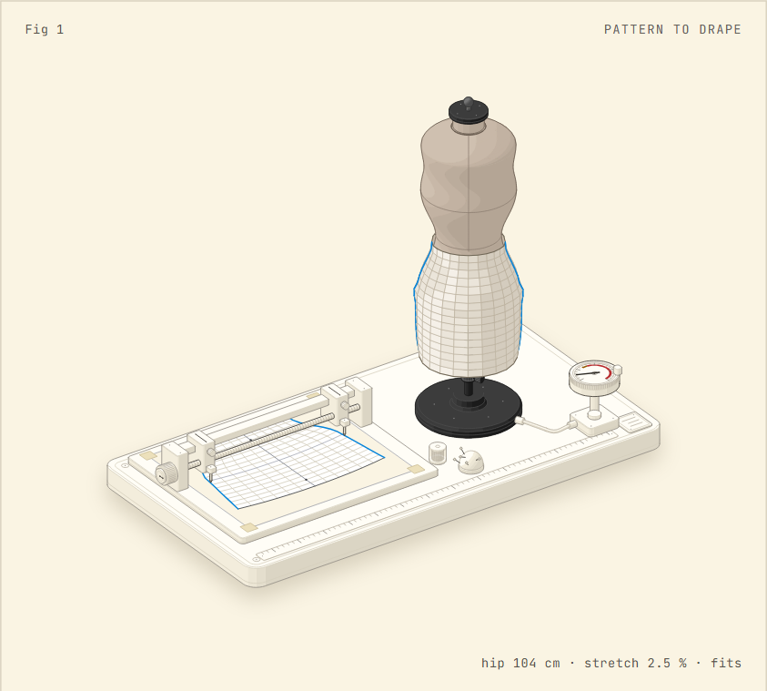
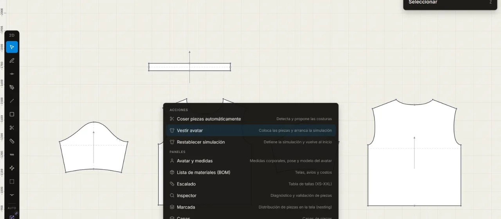

# Vina

[](LICENSE)
[](tsconfig.json)
[](src/utils/cloth/gpu)
[](crates/xpbd-wasm)

Pattern-making CAD in the browser: an editable 2D pattern, real-time cloth on an avatar, and a copilot that knows a dart from a notch. Free, MIT, in the making.

<p align="center">
  <picture>
    <source media="(prefers-color-scheme: dark)" srcset="docs/assets/pattern-to-drape-dark.webp">
    
  </picture>
</p>

**Fig. 1.** A reduced model of Vina's drape. A skirt pattern is cut twice, sewn at the sides and draped on a dress form. Each crossing of the toile's grid is a particle, stepped with XPBD and the solver constants Vina uses (15 substeps a frame, damping 0.99). The pattern's hip goes from 104 to 93 to 114 cm, and the meter reads the worst row's stretch against the fit map. Sewing is shown at ⅛ speed.

**[Open the workshop](https://vina.sdar.dev/app/)** · [vina.sdar.dev](https://vina.sdar.dev/) · [Español](https://vina.sdar.dev/es/) · [Contributing](CONTRIBUTING.md) · [Architecture](docs/specs/ARCHITECTURE.md)

## What it does today



<!-- hoy -->
- **Drafting.** Pen, rectangle, notches and seam allowances, with the grainline drawn and the dimensions written where they measure. Darts come in with your DXF. · [`dock2dTools.ts`](src/components/shell/dock2dTools.ts), [`tiposDeEsquina.ts`](src/utils/seam/tiposDeEsquina.ts), [`notchAnchor.ts`](src/utils/notchAnchor.ts), [`grainLine.ts`](src/utils/grainLine.ts), [`dartEntity.ts`](src/utils/dartEntity.ts)
- **Sewing.** Sew pieces automatically or edge to edge, and watch the seams close in 3D. · [`caminarCostura.ts`](src/utils/seam/caminarCostura.ts), [`autoSewTools.ts`](src/copilot/action/tools/definitions/autoSewTools.ts), [`cloth`](src/utils/cloth)
- **Drape.** Fabric simulated in real time on the avatar, with WebGPU inside the browser. A fit map from the first frame. · [`gpu`](src/utils/cloth/gpu), [`fitMaps.ts`](src/utils/cloth/fitMaps.ts), [`xpbd_wasm_bg.wasm`](public/wasm/xpbd_wasm_bg.wasm), [`avatares`](public/avatares)
- **Reads.** DXF-AAMA · DXF-ASTM · [`formatProfiles.ts`](src/utils/dxf/formatProfiles.ts), [`AppShell.tsx`](src/components/shell/AppShell.tsx)
- **Writes.** DXF-AAMA · PDF at 1:1 · BOM (CSV) · glTF · USDZ · 360° turn · [`uiExport.ts`](src/utils/export/uiExport.ts), [`ExportSection.tsx`](src/components/Viewport3D/renderSections/ExportSection.tsx), [`LogoMenu.tsx`](src/components/shell/LogoMenu.tsx)
- **Copilot.** Ask it to add a dart or to audit the seam allowances. Same tools as yours, and every change can be undone. With your own key. · [`registry.ts`](src/copilot/connections/registry.ts), [`definitions`](src/copilot/action/tools/definitions)

Each line links to the code that makes it true; a test fails if that code goes away (`tests/repo/home-honestidad.test.ts`).
<!-- /hoy -->

## In the making

<!-- en-construccion -->
- Real grading. Sizes scale in proportion today; rules per point come next. · [#915](https://github.com/sssamuelll/vina/issues/915)
- A marker you can export. The nesting panel estimates fabric use and stops there. · [ROADMAP](https://github.com/sssamuelll/vina/blob/main/ROADMAP.md#next)
- A dart tool. Darts arrive with your DXF or the copilot, not from the pen yet. · [ROADMAP](https://github.com/sssamuelll/vina/blob/main/ROADMAP.md#next)
- Project files. Your work lives in this browser until .vina files can be saved. · [#15](https://github.com/sssamuelll/vina/issues/15)
- The interface in English. The workshop speaks Spanish. · [#964](https://github.com/sssamuelll/vina/issues/964)
- Fabrics measured from cloth. Thirty-two presets today. · [#1005](https://github.com/sssamuelll/vina/issues/1005)
<!-- /en-construccion -->

The workshop's interface is in Spanish, for professional pattern makers. Contributor docs and code are in English.

## Send a pattern

Email a DXF (AAMA or ASTM) to **contact@sdar.dev**. You get it back sewn and draped in Vina, with its fit map, and an honest note on where Vina fell short. Every pattern that comes in is a test the workshop hasn't passed yet. A few each month.

## Quick start

```bash
git clone https://github.com/sssamuelll/vina.git
cd vina
npm install
npm run dev        # workshop at http://localhost:5173/app/ — the home is at /
npm test           # the unit suite
```

WebGPU runs in current Chrome, Edge and other Chromium browsers; without it the simulation falls back to the WASM tier. You only need Rust and `wasm-pack` to change the cloth solver in `crates/xpbd-wasm`.

## How it's made

Each change starts as a written design in [`docs/superpowers/specs/`](docs/superpowers/specs/), gets a review, and lands with its tests. The research behind the public pages is in [`docs/reports/`](docs/reports/). The commit gate is in [CONTRIBUTING.md](CONTRIBUTING.md); GitHub Actions stay off on purpose and releases are cut locally after the full gate ([`scripts/deploy-prod.sh`](scripts/deploy-prod.sh)).

The copilot runs with your own key (Anthropic, OpenAI, DeepSeek or a local Ollama). Your own agent can work on the pattern open in Vina through the MCP bridge: [`mcp/`](mcp/) and [`vina-studio`](studio/) on npm.

## Tech stack

React 18 · Redux Toolkit · Three.js (WebGPU renderer) · Vite 6 · Rust + wasm-pack · Vitest + Playwright. TypeScript in strict mode throughout.

## Architecture at a glance

```
src/
├── components/   # React UI: shell, 2D PatternEditor, 3D Viewport
├── copilot/      # AI copilot: agentic loop, tools, knowledge
├── store/        # Redux slices + middleware
├── utils/        # engines: cloth/, dxf/, grading/, nesting/, seam/, mesh/
└── workers/      # Web Worker pool (WASM + CPU solvers)

crates/xpbd-wasm/ # Rust XPBD cloth solver → public/wasm/
mcp/, studio/     # the MCP bridge and its npm package, vina-studio
home/             # the public home: template, copy, data, assets
docs/             # specs, research, RFCs, historical plans
```

Full write-up in [docs/specs/ARCHITECTURE.md](docs/specs/ARCHITECTURE.md). The [docs index](docs/README.md) maps the rest.

## Contributing

Start with [CONTRIBUTING.md](CONTRIBUTING.md) for setup, the commit gate and conventions, then the [open issues](https://github.com/sssamuelll/vina/issues). The gate before a commit:

```bash
npx tsc -b --noEmit && npm run test && npm run lint && npm run lint:ui
```

---

MIT licensed. Third-party notices are in [THIRD-PARTY-NOTICES.md](THIRD-PARTY-NOTICES.md).
