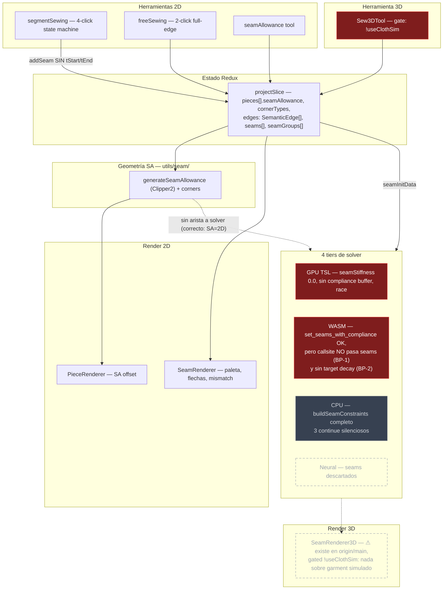

# Plan: Costura con paridad CLO3D — darle salida a OpenClo

> **Date:** 2026-06-11
> **Status:** Ready to execute
> **Origin:** Roster workflow `wf_346c5bbc-eb7` — recon (5 agentes) + benchmark CLO3D (3 agentes) + consejo (Serrano, Voronov, Halberg, Iris Tane, Richter, Kenji) + triage (Cassian Stride).
> **Companion docs:**
> - Acta completa del consejo: `docs/reports/2026-06-11-roster-seam-sewing-council.md`
> - Benchmark CLO3D (spec falsable): `docs/research/2026-06-11-clo3d-sewing-ux-reference.md`

---

## 0. Veredicto en una frase

**Doce PRs (#857-868) se gastaron en seam allowance — que es anotación 2D sin física — mientras el demo-killer real era una línea: el tier por defecto (WASM) simula con CERO costuras porque `useSimulationLifecycle.ts:406` nunca le pasa `seamInitData` al solver.** Las piezas se caen, el usuario dice "no funciona", y ningún incremento de SA podía arreglarlo.

## 1. Diagnóstico en tres niveles

### N1 — Mecánico (Halberg, verificado por Cassian contra `origin/main`)

| ID | Hallazgo | Evidencia |
|---|---|---|
| BP-1 | El tier por defecto (WASM) corre con 0 seams. Toda la maquinaria existe (`set_seams_with_compliance`, `solve_seams` en Rust, wiring del worker) y está muerta en el único callsite. Los seams solo funcionan cuando WASM *falla* y cae a CPU | `useSimulationLifecycle.ts:406` — `wasmClient.initMultiPiece(placedMeshes)` sin seams; la firma ya los acepta |
| BP-2 | Aun cableado, WASM no cierra costuras: `seam_target` estático. El shrink schedule (0.97/substep) solo existe en el solver CPU JS | `crates/xpbd-wasm/src/lib.rs:593-638` vs `seamAssembly.ts:504-511` |
| BP-3 | `segmentRange` tiene DOS espacios de índice incompatibles: el productor escribe command-space (1 segmento por PathCommand), los consumidores leen flattened-space (cada curva = 12 puntos). Cualquier pieza con curvas (sisa, escote = el caso normal) cose los vértices equivocados | `semanticEdges.ts` (productor) vs `seamAssembly.ts:429`, `seamPairs.ts`, `edgePicker.ts` (consumidores) |
| BP-4 | Pérdida silenciosa de constraints: tres `continue` sin telemetría; un seam puede resolver a 0 constraints y la sim corre "exitosa" — piezas caen sin señal. Indiagnosticable hasta para el propio equipo | `seamAssembly.ts:389,393,424`; `gpuSolverClient.ts` fallback `?? 0` liga a pieza 0 |
| BP-5 | Cuatro tiers, cuatro semánticas de seam incompatibles, sin flag `seams` en `SolverCapabilities` — violando la doctrina A7/C4 que este repo ratificó para steamBrush/meshGrab | GPU: `seamStiffness: 0.0` + snap rígido + race sin coloring; Neural: descarta seams; CPU/WASM: compliance per-constraint |

### N2 — Modelo de datos (Voronov, Richter)

El defecto estructural por el que **cada incremento no acumula**: no existe una entidad **boundary** (contorno orientado de pieza, parametrizado por arc-length, con intervalos estables). Cuatro sistemas de direccionamiento incompatibles apuntan al mismo objeto conceptual: índices de comando (`cornerTypes`, `segmentRange`), nombres string (`Seam.edgeName`, con fallback `edge-N` que colapsa a posicional), `SemanticEdge.id` (destruido al regenerar edges), y parámetro t (relativo a *cuál* flattening). Además:

- `Seam` **no tiene campo de dirección**: el cosido cruzado (el modo de fallo nº 1 del oficio) es inexpresable, indetectable y sin remedio — el Ctrl+B de CLO3D no tiene nada que invertir.
- `SemanticEdge` conflata clasificación heurística (regenerable) con identidad referencial (debe ser estable): la física depende de si una heurística de bounding-box adivinó bien.
- El path `generative` de `loadProject` regenera `piece.edges` destruyendo per-edge SA widths del usuario.

**Decisión del plan:** este refactor (boundary entity) es correcto y es **POST-SHIP** — no se re-arquitectura un dominio sin una versión shippeada que lo valide (Cassian). Queda como épica propia (§6).

### N3 — Verdad visual (Iris Tane; re-validar claims contra `origin/main` antes de ejecutar Fase 6)

- El SA se dibuja como hairline dashed (el elemento más débil del canvas); en CLO3D es **área gris rellena** con peso propio. Categoría equivocada: el SA es área (tela), no línea.
- **Identidad, estado y error colapsados en un canal de color**: el color del par desaparece exactamente cuando interactúas (selected lo recolorea); 4 verdes con 4 significados; el mismo naranja significa "error" y "seam #4"; overlays hermanos invierten la asignación (primera selección = verde en uno, azul en otro).
- Las flechas mid-edge + connection line midpoint-a-midpoint hacen **estructuralmente imposible** mostrar el cruce en X — la señal de error más importante de CLO3D.
- Tension y Shrinkage son la misma variable renderizada dos veces (`shrinkage = 100 - tension`). Mismatch en % relativo; el oficio trabaja en mm.

### Meta — Estado del repo (Richter detectó, Cassian resolvió)

El worktree local (`chore/housekeeping-gitignore-audit-doc`, main local ~#807) **no contiene** los PRs #857-870 que sí están en `origin/main` (06763b9a). Parte de la crítica visual ya está parcialmente cerrada en origin/main (`effectiveSeamAllowanceWidth` en render, `SeamRenderer3D` existe gated `!useClothSim`). **Toda rama de este plan nace de `origin/main` tras `git fetch`.**

## 2. El benchmark: qué hace CLO3D que nosotros no

Resumen operativo (spec completa en el companion doc de research):

1. **SA por segmento, como área**: click en cada segmento del contorno → área gris derivada del outline (jamás editable directamente; editas el patrón y el SA sigue). Default 1cm. Corner types por punto, condicionados a qué lados tienen SA.
2. **Sewing como par de mitades orientadas**: Segment Sewing = 2 clicks (hover resalta el segmento, muestra diferencia de longitud en vivo, **roja si >1mm**); el **directional notch** (marca perpendicular junto al punto de inicio) codifica dirección + inicio + paridad; notches cruzados = pieza cosida invertida, remedio = **Reverse Sewing (Ctrl+B)**.
3. **Color = emparejamiento**: cada par tiene color chip estable (Object Browser + canvas); borrar una mitad borra el par; las sewing lines viven en 2D y 3D simultáneamente; cosido cruzado se ve como **X** en las líneas de conexión 3D.
4. **M:N**: selección M + Enter, N + Enter; N se subdivide proporcionalmente.
5. **Edit Sewing**: seleccionar, mover, ajustar extremos, reverse, delete, fold angle/strength.

## 3. Núcleo shippable (Cassian)

> **Dos piezas (con curvas) se cosen con 2 clicks por par, el seam cierra en ≤2s en el tier por defecto (WASM), cada par se identifica por color estable con tick de inicio que delata el cosido cruzado (Ctrl+B lo invierte), el SA se ve como margen por-edge honesto, y cuando un seam no genera constraints el usuario recibe un aviso explícito en vez de una prenda que se cae.**

## 4. Fases de ejecución (cada una = 1 PR desde `origin/main`)

| # | PR | Contenido | Done verificable | Est. |
|---|---|---|---|---|
| **0** | (sin PR) Reconciliación + repro | `git fetch` + actualizar `main` local + rama desde `origin/main`. Test repro: 2 piezas curvas + 1 seam → init WASM → assert `constraint count > 0` y mapeo a vértices correctos (hoy falla doble: BP-1 y BP-3) | Test rojo commiteado en la rama de Fase 1 | 2-3h |
| **1** | `fix(sim): pass seamInitData to WASM tier` | `useSimulationLifecycle.ts:406` → `wasmClient.initMultiPiece(placedMeshes, seamInitData)` + extensión de la suite boundary-contract Epic-746 (`WasmSolverClient` recibe seams) | Sim default muestra piezas atrayéndose; contract test verde | 2-3h |
| **2** | `feat(wasm): seam target decay` | Shrink schedule en `lib.rs::solve_seams` (decay per-substep con floor `sewedThreshold`) o decay desde el worker; tunear cierre ≤2s en CPU y WASM. **Rebuild WASM: copiar `xpbd_wasm.js` Y `xpbd_wasm_bg.wasm` a `public/wasm/`** | `cargo test` del decay; E2E: distancia de seam < threshold en ≤2s de sim-time | 6-8h |
| **3** | `fix(seam): canonical segmentRange space` | Flattened-space canónico EN LA FRONTERA: helper único `commandRangeToFlattened(outline, range)` consumido por `seamAssembly.ts`, `seamPairs.ts`, `edgePicker.ts`. Si cubre `cornerTypes` barato, incluir | Test de Fase 0 verde con curvas; pick 3D resalta el sub-polyline correcto | 6-8h |
| **4** | `feat(sim): seam observability + capability gating` | Flag `seams` en `solverCapabilities.ts`; cascade salta GPU/Neural si el proyecto tiene seams; toast + errors slice (convenciones E-async-states) + constraint-count en `SimulationStatusOverlay` cuando un seam resuelve a 0 constraints; eliminar fallback `?? 0` de `gpuSolverClient` | Proyecto con edge irresoluble → toast visible; GPU opt-in con seams → cae a WASM con aviso | 4-6h |
| **5** | `feat(seam): direction + reverse (Ctrl+B)` | Campo `reversed` en una mitad de `Seam`; `parameterizeEdge` invierte t; acción reverse + shortcut Ctrl+B + **registro en el copilot tool registry** (convención del proyecto); `SeamRenderer`: connection lines start-a-start + tick perpendicular de inicio en t≈0.05 (la X cruzada aparece gratis); mitigación segmentSewing: snap a segmento completo (NO despachar t-ranges sin renormalización — arma el bug del solver) | Seam invertido dibuja X en 2D; Ctrl+B la deshace; sim ya no retuerce la pieza | 6-8h |
| **6** | `fix(ui): seam visual truth` | Color de par estable (sin override por estado; selected = peso, no recolor), mismatch en mm absolutos rojo >1mm, highlight de selección para SA tool en canvas, SA como área rellena gris, borrar slider Shrinkage (duplica Tension, `SeamPropertiesPanel.tsx:52-61`), preservar per-edge widths en generative load (re-key por nombre). **Re-validar cada claim de Iris contra origin/main antes de tocar** | Screenshots diff por cada corte | 4-6h |

**Total: 30-42h.** Checkpoint interno **viernes 13-jun**: Fases 0-2 — la prenda SE COSE en el tier por defecto (el demo-killer muere ahí). **Ship propuesto: viernes 19-jun**, Fases 0-6.

Gates en cada PR (manuales — el hook Husky no está enforced): `npx tsc -b --noEmit && npm run test && npm run lint`.

## 5. Cortes explícitos (no entran en este release)

| Item | Decisión | Nota |
|---|---|---|
| Refactor boundary entity (Voronov/Richter completo) | DEFER → épica post-release (§6) | El mejor argumento para hacerlo bien es un release que enseñe dónde duele |
| Partial-edge sewing (tStart/tEnd dispatch + renormalización) | DEFER | Solo como pareja atómica — arreglar la UI sola arma el bug del solver. CLO3D Segment Sewing es full-segment de 2 clicks; el núcleo no lo necesita |
| SeamGroup M:N | DEFER | Inimplementable hasta post-Fase 3 |
| GPU seam kernel parity (compliance SBA + coloring + decay) + Neural seams | DEFER, gated por capability flag (Fase 4) | GPU es opt-in localStorage y está bloqueado por atomicAdd de Three.js 0.183 |
| Seam lines sobre el garment simulado | DEFER fast-follow | El seam cerrado ES la visualización; `SeamRenderer3D` hoy gated `!useClothSim` |
| Live seam edit sin teardown (BP-5/BP-6 de Halberg) | DEFER, restart documentado | Semántica de restart aceptable para v0 |
| Slider Shrinkage | **DELETE** (Fase 6) | Misma variable que Tension renderizada dos veces |
| Corner types en outlines curvos (fix completo), polish tipográfico, memoización Clipper2 del offset en `PieceRenderer` | DEFER batch post-ship | Known-issues listados en el PR de release |

**Regla de Cassian:** rechazar un corte exige decir qué item entra y qué fase sale. El default no puede ser "más polish".

### No es defecto (no gastar ni una hora)

- "Per-edge SA width no llega al solver" — **correcto por diseño**: en CLO3D el SA es anotación 2D sin física. No "arreglarlo" hacia el solver.
- "WASM no soporta seams" — falso; BUG-3 #606 cerrado, `set_seams_with_compliance` operativo. El problema es el callsite (Fase 1).
- "Sew3DTool no está en toolbar" — falso; `group: '3d-edit'`.

## 6. Post-ship: las dos épicas estructurales

1. **Boundary como entidad de dominio** (diagnóstico completo de Voronov en el acta): contorno orientado por pieza, parametrizado por arc-length, con intervalos de primera clase y re-anclaje definido bajo edición. SA width, corner type, notch, sewing-half, elastic, topstitch y POM pasan a ser intervalos/puntos sobre ese dominio; render, mesher y solver consumen el mismo polyline canónico (los vértices de frontera *nacen* con identidad de costura). Nota de Voronov: `Elastic` (`edgeName + tStart/tEnd + width + active`) ya tiene la forma más cercana a la correcta. Prerrequisito también del copilot (un agente no puede razonar sobre `Record<number, CornerType>`). **Escalar a evaluación de prioridad post-release.**
2. **"Como CLO3D" como spec falsable**: convertir el benchmark (`docs/research/2026-06-11-clo3d-sewing-ux-reference.md`) en replay-scripts E2E (Playwright) — uno por comportamiento del manual. Backlog de QA.

## 7. Riesgos y guardarraíles

- **WASM sync (non-negotiable de CLAUDE.md):** Fase 2 toca `crates/xpbd-wasm/src/lib.rs` → copiar `xpbd_wasm.js` Y `xpbd_wasm_bg.wasm` a `public/wasm/`. JS-only copy = fallback CPU silencioso (exactamente la clase de bug que estamos matando).
- **Branch hygiene:** cada fase nace de `origin/main` actualizado; nunca empujar fixes a ramas de PRs ya mergeados.
- **Claims stale:** los veredictos del consejo corrieron parcialmente sobre el árbol local desfasado. Cassian ya re-verificó los de runtime (todos ciertos en origin/main); los visuales de Iris se re-validan en Fase 6 antes de tocar código.
- **Orden importa:** no adelantar la Fase 5 (dirección) antes de la 3 (espacios de índice) — el tick de dirección dibujado sobre el sub-polyline equivocado sería peor que no tenerlo.
- **No cobardes:** el gating de GPU/Neural (Fase 4) no es "desactivar la feature": es declarar honestamente una capability ausente vía la doctrina A7/C4 ya ratificada, con aviso visible al usuario y fallback automático al tier que sí cose.

## 8. Mapa del pipeline (Kenji)

Mapa del estado del árbol local (pre-#857; las zonas marcadas ⚠ stale ya existen en origin/main pero los breakpoints rojos persisten):

Diagrama completo con todas las rutas de archivo en el acta del consejo.
