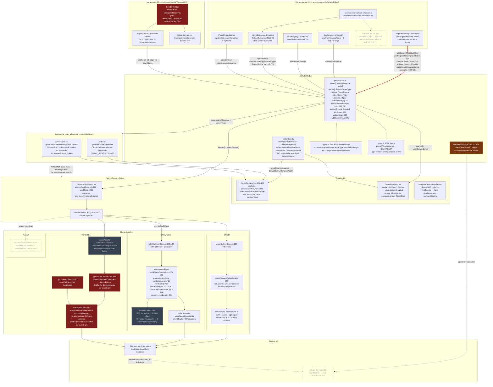
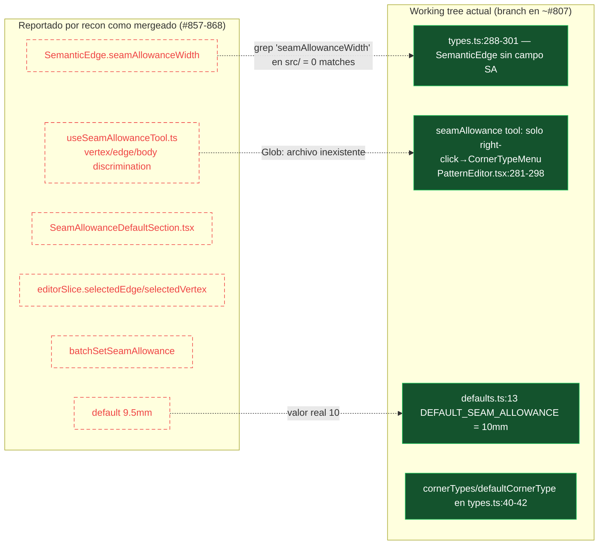

# Roster Council — Seam/Sewing CLO3D Parity (acta completa)

> **Date:** 2026-06-11
> **Origin:** Roster workflow `wf_346c5bbc-eb7` (15 agents: 5 code recon + 3 CLO3D web research + 6 council + 1 ship triage).
> **Companion docs:** plan at `docs/plans/2026-06-11-clo3d-seam-sewing-parity-plan.md`, CLO3D benchmark at `docs/research/2026-06-11-clo3d-sewing-ux-reference.md`.

## ⚠️ Caveat de estado de árbol (léelo antes que nada)

El recon y parte del consejo corrieron sobre el **working tree local** (branch `chore/housekeeping-gitignore-audit-doc`, main local ~PR #807), que **NO contiene** los PRs #857-870 mergeados en `origin/main`. Richter, Serrano y Kenji detectaron la divergencia; **Cassian re-verificó los hallazgos uno a uno contra `origin/main` (06763b9a)**: los breakpoints de runtime de Halberg (BP-1..BP-6) son ciertos en origin/main; varios claims visuales de Iris ("SA fantasma `||`", "per-edge width ignorado en render", "`showSeamlines3D` huérfano / `SeamRenderer3D` inexistente") están **parcialmente stale** — en origin/main `PieceRenderer` ya consulta `effectiveSeamAllowanceWidth` y `SeamRenderer3D.tsx` existe (gated `!useClothSim`). Toda planificación debe partir de `origin/main` y re-validar los claims marcados.

---

## Serrano — auditoría de spec (riesgo)

**A) Diagnostic Summary**

Documento auditado: la implementación actual de seam allowance + sewing en el working tree (branch `chore/housekeeping-gitignore-audit-doc`, limpio) tratada como spec. Estado: NO implementable como base de paridad CLO3D — el contrato central (`SemanticEdge.segmentRange`) tiene dos interpretaciones de índice incompatibles vivas en producción, y el recon entregado describe features (per-edge SA width, `useSeamAllowanceTool`, `selectedEdge` en Redux, default 9.5mm, PRs #857-868) que **no existen en este árbol** (grep = 0 matches). 3 BLOCKERS, 5 HIGH. La percepción del usuario de "no funciona" tiene causas mecánicas verificables, no solo de UX.

**B) Findings**

1. **[BLOCKER] [CONTRA][AMB] `SemanticEdge.segmentRange` tiene dos espacios de índice contradictorios, ambos en producción**
Evidence: `src/types/types.ts:293` — "Index range [start, end) in the outline PathCommand array" vs `src/utils/cloth/seamAssembly.ts:402` — "segmentRange uses indices into the flattened outline".
Problem: el productor `detectSemanticEdges` (`src/utils/semanticEdges.ts:27-58,231`) escribe índices de PathCommand (1 segmento por comando, C/S/Q = 1). Consumidores en command-space: `resolveEdgeName` (`src/components/PatternEditor/sewingUtils.ts:40-44`), `src/utils/patternRules.ts:107-109`, `modifyDimension.ts:132`. Consumidores en flattened-space (cada curva expande a 12 puntos): `seamAssembly.ts:429-430` (`parameterizeEdge`), `src/utils/cloth/seamPairs.ts`, `src/utils/3d/edgePicker.ts:136,158`, `src/utils/export/bomExtractor.ts:85-92`.
Impact: cualquier seam sobre una pieza con curvas (sisa, escote — el caso normal en patronaje) genera constraints 3D sobre el rango de vértices EQUIVOCADO (corrimiento de +11 índices por cada curva previa). El picking 3D (`pickEdge`) resalta el sub-polyline equivocado. Esto explica directamente "el cosido no se acerca a CLO3D": solo funciona bien en polígonos rectos.
What needs to be decided: ¿cuál es el espacio de índice canónico de `segmentRange`, y qué capa hace la conversión?

2. **[BLOCKER] [CONTRA][STATE] `piece.cornerTypes` se escribe en command-space y se lee en flattened-space**
Evidence: write — `PatternEditor.tsx:61-77` (`findNearestVertex` itera `outline[i]`, solo M/L) → `cornerTypes[hit.index]` (línea 255); read — `src/utils/seam/cornerTypes.ts:525,563` (`cornerTypes[i]` con `i` = índice en `flattenPath(outline)`).
Problem: con cualquier curva en el outline, el override de esquina cae en el vértice equivocado al renderizar. Además: (a) vértices finales de C/Q nunca son seleccionables (línea 69 `if (cmd.type !== 'M' && cmd.type !== 'L') continue`); (b) `shiftCornerTypes` (`cornerTypes.ts:470`) tiene **cero callsites de producción** (solo tests) — insertar/eliminar vértices corrompe las claves silenciosamente; (c) `upsertPieceOutline` borra todos los cornerTypes (`projectSlice.ts:604,628`) — edición paramétrica destruye configuración de usuario sin aviso.
Impact: la feature de corner types es funcional solo en polígonos M/L estáticos; en el resto produce geometría errónea o pérdida silenciosa de estado.
What needs to be decided: ¿clave estable para corner overrides (índice posicional vs id de vértice) y en qué espacio?

3. **[BLOCKER] [CONTRA][SCOPE] El recon de los 5 exploradores no corresponde a este working tree**
Evidence: grep `seamAllowanceWidth` = 0 archivos; no existen `src/components/PatternEditor/useSeamAllowanceTool.ts`, `SeamAllowanceDefaultSection.tsx`, `batchSetSeamAllowance`, `selectedEdge`/`selectedVertex` en `editorSlice.ts` (verificado: solo `selectedSeamId`, `selectedPieceIds`, `defaultSeamAllowanceWidth`); `docs/api/seam-allowance.md` no existe.
Problem: los PRs #857-868 (per-edge SA, multi-select Shift, 9.5mm) no están en esta rama. Sí existen: `cornerTypes.ts`, `CornerTypeMenu`, `seamPairs.ts`, `Sew3DTool`, `useSegmentSewingTool`. Los exploradores [seam-allowance] y [data-model] se contradicen entre sí (uno dice "per-edge width sin UI", otro "UI sin render") y ambos contradicen el árbol.
Impact: cualquier plan de fix construido sobre "per-edge SA ya existe, solo falta el render" es inválido aquí. Riesgo de duplicar o pisar trabajo en otra rama.
What needs to be decided: ¿contra qué ref se trabaja? ¿#857-868 están mergeados a `main` post-divergencia de esta rama, o viven en otra rama?

4. **[HIGH] [CONTRA][GAP] segmentSewing captura sub-segmentos (startT/endT) pero el Seam despachado los descarta**
Evidence: `useSegmentSewingTool.ts:247-254` guarda `startT/endT` en tool state; líneas 321-336 el `Seam` despachado solo lleva `pieceId + edgeName` — sin `tStart/tEnd`, pese a que `Seam` los soporta (`types.ts:309-311`) y `buildSeamConstraints` los consume (`seamAssembly.ts:433-438`).
Impact: el usuario cose un tramo con UX de 4 clicks y la simulación cose el edge completo. `SeamRenderer.tsx:93-97` valida mismatch sobre edges completos, consistente con el dato corrupto, no con la intención del usuario.
What needs to be decided: ¿el seam persiste el rango t del gesto o el gesto debe restringirse a edges completos?

5. **[HIGH] [CONTRA][STATE] Semántica de seams divergente por tier de solver, sin capability flag**
Evidence: GPU — `gpuSolverClient.ts:354` (`seamDist.push(0)`: target 0 desde frame 0, sin shrink progresivo ni tension), `:383` (`seamStiffness: 0.0` uniforme), `tslSolver.ts:599-611` (null compliance buffer; "uniform compliance"); `seamInitDataToPairs` descarta type/strength/taped/tension. CPU/WASM — compliance por-constraint por tipo + `shrinkFactor: 0.97` + `restLength = currentDist * (tension/100)` (`seamAssembly.ts:111-120,443-474`; `crates/xpbd-wasm/src/lib.rs:207,593-623`). `solverCapabilities.ts`: ningún flag `seams`.
Impact: el mismo proyecto se cose con física distinta según tier (GPU: tirón rígido instantáneo; CPU/WASM: cierre progresivo modulado). Nota: la afirmación del recon "WASM no soporta seams" es **falsa** en este árbol (`wasmSolverWorker.ts:580-590` usa `set_seams_with_compliance`, BUG-3 #606 cerrado).
What needs to be decided: ¿GPU debe igualar el contrato CPU/WASM (per-constraint compliance buffer + shrink) o declararse degradado vía `SolverCapabilities`?

6. **[HIGH] [GAP][OPS] Fallos silenciosos en resolución de seams → 0 constraints sin ningún log**
Evidence: `seamAssembly.ts:389,393,424` — tres `continue` sin warning (outline ausente, piece offset ausente, edgeName irresoluble); `gpuSolverClient.ts:350-351` — `vertexOffsets.get(sp.pieceAId) ?? 0` liga constraints a la pieza 0 si falta el id.
Impact: piezas dibujadas a mano / importadas sin `edges` semánticos producen seams que existen en UI pero no en el solver — las piezas caen sin coserse y el usuario no recibe ninguna señal. Coincide con el P0 ya documentado en `docs/specs/SEAM-ANALYSIS-2026-03-26.md` y sigue abierto.
What needs to be decided: ¿qué superficie de error usa el fallo de resolución (toast / diagnostics inspector / errors slice, per eje E-async-states)?

7. **[HIGH] [GAP][UX] La visualización 3D del cosido no existe; el toggle está muerto y la herramienta 3D se desmonta en silencio**
Evidence: `showSeamlines3D` (`simulationSlice.ts` + `DisplayBar3D.tsx`) — único consumidor no-test es `FitMapToggle.test.tsx:47`; ningún `SeamRenderer3D` en `Viewport3D.tsx`; `Viewport3D.tsx:715` — `{activeTool3D === 'sew3d' && !useClothSim && ...}` con `useClothSim = simulationState !== 'idle'` (línea 166).
Impact: (a) botón "Seamlines" en DisplayBar3D que no hace nada — dead UI; (b) con simulación activa, el tool sew3d sigue seleccionado en la toolbar pero su componente no se monta: clicks sin efecto y sin feedback; (c) seams creados en 3D no tienen representación persistente — queja #3 del usuario. Nota: el recon dice "Sew3DTool no aparece en toolbar"; falso — `group: '3d-edit'` lo hace alcanzable vía `Toolbar3D.tsx:40-55`.
What needs to be decided: ¿cuál es la representación 3D pre-simulación y durante simulación de un seam (líneas entre midpoints, sobre mesh deformado, etc.)?

8. **[HIGH] [CONTRA][UX] El tool seamAllowance promete per-edge pero no tiene ni interacción de click-edge ni modelo de datos per-edge**
Evidence: única interacción de canvas = right-click cerca de vértice M/L → `CornerTypeMenu` (`PatternEditor.tsx:281-298`); `seamAllowance.tsx:32` (copilot description): "Different edges may require different allowance widths…"; el modelo solo tiene `piece.seamAllowance` global.
Impact: el flujo nuclear de CLO3D (click en segmento → SA gris por-segmento, default 10mm) no tiene superficie de implementación; el copilot puede prometer al usuario operaciones per-edge que ningún reducer puede ejecutar. El ancho se edita solo en `PieceProperties` por pieza.
What needs to be decided: ¿el SA es per-pieza (estado actual) o per-segmento (CLO3D)? La decisión condiciona el modelo de datos antes de cualquier fix de UX.

9. **[MEDIUM] [AMB][GAP] Semántica del valor 0 de SA indistinguible del default + corner functions aplicadas a cada sample de curva**
Evidence: `PieceRenderer.tsx:169-175` — `piece.seamAllowance || defaultSeamAllowanceWidth` (OR falsy) y `hasCustomCorners` incluye `defaultCornerType !== 'mitered'`.
Impact: (a) imposible expresar "esta pieza sin SA" mientras el default global > 0; (b) con `defaultCornerType` = 'envelope'/'squared' en outline curvo, la corner function se ejecuta en cada uno de los ~12 puntos aplanados por curva → tabs/geometría basura a lo largo de la curva.
What needs to be decided: ¿`seamAllowance: 0` significa "sin SA" o "usa default"? ¿Los corner types aplican solo a vértices "reales" (esquinas) y no a samples de curva?

10. **[MEDIUM] [STATE] Selección de edges no es estado de primera clase**
Evidence: `editorSlice.ts:12,48-97` — solo `selectedSeamId` y `selectedPieceIds`; toda selección de edge vive en `useState` local de cada tool hook.
Impact: no undo, no inspección por copilot/properties panel, se pierde al cambiar de tool; imposible construir el flujo CLO3D "seleccionar segmento → Property Editor" sin esta decisión previa.
What needs to be decided: ¿dónde vive `selectedEdge` (Redux cross-feature vs tool-local, per convención E-async-states)?

11. **[MEDIUM] [GAP] SeamGroup (M:N) empareja por índice y descarta el excedente**
Evidence: `GarmentSimulation.tsx:83-89` — `count = Math.min(edgesA.length, edgesB.length)`; pares `edgesA[i]↔edgesB[i]`.
Impact: M:N real (CLO3D subdivide N proporcionalmente a M) no existe; con M≠N los edges extra se descartan en silencio. No hay UI ni tool que cree SeamGroups — tipo definido (`types.ts:356-366`), pipeline a medio construir.
What needs to be decided: ¿semántica de reparto proporcional para M:N, o eliminar SeamGroup del modelo hasta que exista?

12. **[MEDIUM] [AMB][UX] No existe el invariante de dirección (directional notch) del cosido**
Evidence: `Seam` (`types.ts:306-324`) no codifica dirección/paridad; `SeamRenderer.tsx` dibuja flechas pero nada valida anti-paralelismo ni ofrece reverse (Ctrl+B de CLO3D).
Impact: el modo de fallo más común de cosido (mitades en sentidos opuestos → pieza cosida girada/invertida en sim) es inexpresable, indetectable y sin remedio de 1 acción. La dirección efectiva queda implícita en el orden de vértices de `parameterizeEdge`.
What needs to be decided: ¿cómo se representa y se invierte la dirección de cada mitad del seam?

13. **[LOW] [AMB] Umbrales de hit heterogéneos sin rationale declarado**
Evidence: `sewingUtils.ts:24-25` (15px/10px screen), `PatternEditor.tsx:283` (10px), `edgePicker.ts:137` (15mm world).
Impact: precisión de selección distinta entre 2D y 3D al mismo zoom; fricción de la queja #2.

14. **[LOW] [ASSUMP] `maxEdgeLength = 15` hardcoded asumiendo paridad con el mesher CDT**
Evidence: `seamAssembly.ts:426-427` — "Default maxEdgeLength is 15 in CDT, but we should ideally pass this from config".
Impact: si el mesher cambia su threshold, los índices de vértices subdivididos divergen y los seams mapean a partículas equivocadas sin error.

**C) Questions the document avoids**

1. ¿Cuál es el espacio de índice canónico de `segmentRange` y `cornerTypes` — PathCommand o flattened? (sostiene F1, F2)
2. ¿Contra qué rama/ref existe el trabajo de PRs #857-868? (sostiene F3)
3. ¿El SA es per-pieza o per-segmento? (sostiene F8; condiciona todo el roadmap CLO3D-parity)
4. ¿Qué tier define la semántica de referencia de seams y cómo se declara la degradación GPU? (sostiene F5)
5. ¿Cuál es la superficie de error cuando un seam no resuelve a constraints? (sostiene F6)
6. ¿Cuál es la representación visual 3D de un seam antes y durante la simulación? (sostiene F7)
7. ¿Cómo se codifica la dirección de cosido y su corrección? (sostiene F12)

**D) Risks by Category**

- *Técnico:* corrupción silenciosa de mapeo 2D→3D en outlines curvos (F1, F2, F14); física divergente por tier sin gate (F5); constraints ligados a pieza equivocada por fallback `?? 0` (F6).
- *Producto:* paridad CLO3D inalcanzable sin decidir per-edge SA y dirección de cosido (F8, F12); promesas del copilot sin backend (F8); dead UI que erosiona confianza (F7); pérdida de intención del usuario en sub-segmentos (F4).
- *Ejecución/Operaciones:* planificación sobre recon desalineado con el árbol → trabajo duplicado o conflicto entre ramas (F3); fallos sin observabilidad → "no funciona" no diagnosticable por el propio equipo (F6, F7); estado tool-local hostil a undo bloquea iteración de UX (F10).

**E) Items requiring immediate clarification (BLOCKERS)**

1. F1 — Espacio de índice canónico de `SemanticEdge.segmentRange` (`src/utils/semanticEdges.ts` vs `src/utils/cloth/seamAssembly.ts` / `src/utils/3d/edgePicker.ts` / `src/utils/export/bomExtractor.ts`). Sin esto, todo fix de cosido sobre curvas es lotería.
2. F2 — Esquema de claves de `piece.cornerTypes` (`src/components/PatternEditor/PatternEditor.tsx:61-77` vs `src/utils/seam/cornerTypes.ts:563`) + ausencia de callsites de `shiftCornerTypes`.
3. F3 — Identificar la ref que contiene #857-868; este árbol no contiene per-edge SA width ni la selección de edges descrita en el recon. Re-validar los findings de los exploradores [seam-allowance] y [data-model] contra esa ref antes de planificar.

---

## Voronov — crítica ontológica

# Crítica ontológica: modelo seam/sewing de OpenClo vs CLO3D

## 0. Veredicto en una línea

OpenClo no tiene una entidad **boundary** (frontera de pieza como 1-manifold con identidad propia). Todo el sistema de costura es un conjunto de anotaciones que apuntan al **formato de serialización de un dibujo SVG** (`outline: PathCommand[]`). Cada feature "sale torcida" porque cada una debe reinventar su propio sistema de direccionamiento sobre una geometría que no fue diseñada para ser direccionada. Esto no es un bug; es estructural.

---

## 1. La restricción invisible

**Regla nunca declarada que gobierna todo el sistema:** *"Toda feature de costura debe expresarse como una referencia hacia el array `outline: PathCommand[]` sin modificarlo jamás."*

CLO3D hace lo contrario: el boundary es **topología mutable** — coser un sub-segmento *subdivide* la frontera (añadir un punto al patrón es una operación de primera clase: "Add Point to Pattern on Start/End"), y las sewing lines viven como intervalos sobre la coordenada intrínseca del boundary (arc-length). En OpenClo el outline es serialización congelada; como nadie puede subdividirlo, han nacido **cuatro sistemas de direccionamiento incompatibles** para apuntar dentro de él:

| Esquema | Quién lo usa | Estabilidad |
|---|---|---|
| Índice de comando (posicional) | `PatternPiece.cornerTypes: Record<number, CornerType>` (types.ts:42), `SemanticEdge.segmentRange: [number, number)` (types.ts:294) | Se rompe con cualquier insert/remove de vértice, scissors, slash&spread |
| Nombre string (nominal) | `Seam.pieceA.edgeName` (types.ts:309), `Elastic.edgeName`, `Pleat.edgeName`, `Trim.placement.edgeName` | Derivado de heurística; fallback `edge-${edgeIndex}` (sewingUtils.ts:40-44) colapsa lo nominal de vuelta a lo posicional |
| `SemanticEdge.id` | per-edge `seamAllowanceWidth` (#857) | Destruido en cada regeneración de edges (ver §3) |
| Parámetro t por arc-length | `tStart/tEnd` en Seam/Pleat/Elastic/POMPoint | Relativo a *cuál* flattening (CURVE_RESOLUTION=12 vs mesher); no canónico |

`projectSlice.ts` tiene `cascadeEdgeRename`/`cascadeEdgeRemove` (líneas 678-711) — maneja cambios de identidad **nominal**, pero la identidad **posicional** no emite eventos de cambio. El sistema cascadea lo que puede nombrar y corrompe silenciosamente lo que solo puede indexar.

## 2. Error de categoría central: `SemanticEdge` conflata tres roles

`SemanticEdge` (types.ts:288-301) es simultáneamente:

- **(a) Clasificación semántica** — "armhole", `matchHint`, para copilot/auto-sew. Naturaleza: heurística, derivada, regenerable, con pérdida. `detectSemanticEdges` clasifica por zona de bounding-box y ángulo (`classifyZone`, semanticEdges.ts:91-100 — literalmente `relY < 0.2 → 'top'`).
- **(b) Identidad topológica referencial** — `Seam.edgeName` ancla constraints físicos a ella. Naturaleza requerida: estable, exacta, persistente.
- **(c) Dominio paramétrico** — `segmentRange` + `tStart/tEnd` + `seamAllowanceWidth`. Naturaleza requerida: geométrica, recomputada al cambiar el outline.

(a) y (b) son ontológicamente incompatibles: **la física del garment depende de si una heurística de bounding-box adivinó bien**. Además `edges?` es opcional (types.ts:52) mientras `Seam.edgeName` es obligatorio — la relación central del dominio referencia un atributo opcional, derivado y regenerable. El skip silencioso de `buildSeamConstraints` con piezas dibujadas a mano no es un descuido: es la consecuencia necesaria de fundar identidad en inferencia.

## 3. Demostración empírica del error (una línea de código)

`projectSlice.ts:289-293`: en **cada** `loadProject`, para toda pieza con `category !== 'other'`:

```ts
piece.edges = detectSemanticEdges(piece);
```

Reemplazo wholesale del array. Cualquier `SemanticEdge.seamAllowanceWidth` editado por el usuario (la feature estrella de #857-868) **se destruye al recargar el proyecto**, y los nuevos `edge.id` huerfanizan todo lo keyed por id. Verificado: `seamAllowanceWidth` aparece **cero veces** en projectSlice.ts — no existe reducer que lo preserve ni backfill (la recon de [data-model] que menciona "per-edge SA backfill in loadProject" es incorrecta en este punto). El usuario guarda anchos por edge en la capa derivada; la capa derivada se regenera; los datos mueren. Esto es el error de categoría ejecutándose en producción. Explica directamente "edité el width y al recargar no está" — la queja (1) del usuario.

El mismo error explica por qué `PieceRenderer.tsx` ignora per-edge width: el renderer camina el **outline** (la geometría); el width vive en la capa **semántica**; no hay join natural entre capas porque están en categorías distintas. No es feature incompleta — es dato colocado en una capa que el renderer no tiene razón ontológica para consultar.

## 4. SA y corners: anotación sobre serialización, no propiedad del boundary

Contrato CLO3D: *"Direct editing is not allowed for seam allowances... edit Pattern outlines"* — SA es **geometría derivada viva**, función `width(s)` sobre la coordenada del boundary, por segmento, regenerada siempre. Corner type es propiedad del **punto entre dos segmentos**, condicionada a qué lados tienen SA (Start/End con 3 opciones vs Intersection con 6).

OpenClo: SA vive en tres lugares de tres categorías (`piece.seamAllowance` escalar de pieza, `SemanticEdge.seamAllowanceWidth` en capa semántica, `editorState.defaultSeamAllowanceWidth` preferencia de editor — types.ts:38, :300-ish, :648), y corner en `Record<number, CornerType>` keyed por posición de serialización. Consecuencias estructurales: (1) toda mutación de outline invalida las keys sin error; (2) el corner type no puede condicionarse a la presencia/anchos de SA adyacentes porque esos viven en otro esquema de keys; (3) el mismatch flattenPath-12-segmentos vs índices de comando es inevitable, no accidental.

## 5. `Seam` modela la relación equivocada

CLO3D: la unidad atómica es la **sewing-line half** — intervalo orientado sobre un boundary, con identidad, directional notch, y existencia transitoria sin pareja (el flujo de creación muestra la mitad A sola). El par es una *relación entre dos halves*; M:N es un *conjunto de halves* con reparto proporcional.

OpenClo (`Seam`, types.ts:306-324): el par **es** la entidad; la half no existe. Por eso:

- `reverseSeam` (projectSlice.ts:735-741) hace swap A↔B — eso es **inversión del par**, no inversión del notch de una mitad. El Ctrl+B de CLO3D (invertir dirección de UNA half) es **inexpresable** en este modelo sin semántica de t-range invertido, que no existe (segmentSewing descarta tStart/tEnd al despachar, per recon [sewing-ux]).
- La dirección de costura no está representada: está implícita en el orden de vértices del outline + cuál pieza es A. El invariante visual de CLO3D (notches paralelos = costura correcta) no tiene dato sobre el que renderizarse. La queja (3) — "cómo se muestra el cosido" — no se arregla con un SeamRenderer3D: no hay entidad que porte dirección, color de par, ni estado half-seleccionada.
- `SeamGroup` (types.ts:356-366) existe como tipo pero sin solver ni UI: es el síntoma de intentar añadir M:N sobre un modelo cuyo átomo es el par cerrado.

## 6. Imposibilidad de composición 2D↔3D

Cadena actual: `Seam.edgeName` → lookup nominal → `segmentRange` (índices de comando) → `flattenPath(12)` → polyline → `parameterizeEdge` (arc-length t) → `matchVertices` por closest-t contra los vértices del **mesh** (maxEdgeLength=15 hardcoded) (seamAssembly.ts:252-292, seamPairs.ts).

El modelo 2D compromete identidad **nominal-posicional**; el constraint 3D necesita identidad **métrica** (qué vértice del mesh está en qué intervalo del boundary). No existe intermedio compartido: el renderer, el picker 3D, el offsetter de SA y el mesher discretizan el boundary **cada uno por su cuenta**, con sus propias constantes. La correspondencia 2D↔3D se *re-infiere por proximidad en cada init de simulación* — inferencia donde debería haber construcción.

**Ley de orquestación:** todo sistema que mapee anotaciones de boundary 2D a constraints de mesh 3D debe o bien (a) hacer canónico y compartido el boundary discretizado — el mesher consume el mismo polyline que porta los intervalos de seam, los vértices de frontera *nacen* con identidad de costura adjunta — o bien (b) aceptar pairing probabilístico para siempre, con skips silenciosos, mismatches y vértices sin pareja en edges de longitud desigual. CLO3D hace (a) implícitamente. OpenClo hace (b). El tier divergence GPU (seamStiffness=0.0 hardcoded, gpuSolverClient.ts:383) y Neural (seams dropped) agrava: los atributos físicos de `Seam` (tension/strength/taped/type) solo son semánticamente reales en CPU/WASM, y `SolverCapabilities` no tiene flag de seams — el tipo promete universalidad que la orquestación no puede honrar y no puede ni reportar.

## 7. Respuestas directas

- **¿Es `outline: PathCommand[]` la abstracción correcta para selección fluida de sub-segmentos?** No. Su átomo seleccionable es el comando SVG. La selección fluida de CLO3D requiere un boundary cuyo átomo sea el *inter-point segment* sobre coordenada arc-length, refinable por subdivisión. La adopción a medias de `t` (existe en tipos, lo consume el solver, lo ignora SeamRenderer, lo descarta segmentSewing) es el sistema evitando la decisión ontológica.
- **¿Viven Seam/SemanticEdge/SA-width en la categoría correcta?** No. `Seam` debería ser relación entre dos *halves* que no existen. `SemanticEdge` debería partirse: clasificación (derivada, regenerable) ≠ identidad topológica (estable, persistente) ≠ dominio paramétrico (recomputado). `SA width` y `cornerTypes` deberían ser propiedades de segmentos/puntos del boundary, no anotaciones sobre la capa semántica ni sobre índices de serialización.
- **¿Qué error explica que todo salga torcido?** Uno solo: ausencia de la entidad boundary. Cuatro sistemas de direccionamiento, regeneración destructiva de la capa que porta datos de usuario, dirección de costura irrepresentable, y pairing 3D por inferencia son los cuatro síntomas del mismo vacío.
- **Punto de presión predicho:** cualquier edición topológica del outline (insert vertex, scissors, slash&spread) desalinea `cornerTypes` y `segmentRange` en silencio. Cada `loadProject` con piezas categorizadas borra per-edge SA. Cada init de simulación re-adivina la correspondencia. Bajo uso real, la frecuencia de estos tres eventos es ~100%.

## Archivos núcleo de la crítica

- `/Users/samueldarioballesterosgarcia/projects/01_products/openclo/src/types/types.ts` (PatternPiece:24-91, SemanticEdge:288-301, Seam:306-324, SeamGroup:356-366, EditorState:637+)
- `/Users/samueldarioballesterosgarcia/projects/01_products/openclo/src/store/projectSlice.ts` (loadProject:278-321 regeneración destructiva; cascades:678-711; reverseSeam:735)
- `/Users/samueldarioballesterosgarcia/projects/01_products/openclo/src/utils/semanticEdges.ts` (clasificación heurística usada como fundamento referencial)
- `/Users/samueldarioballesterosgarcia/projects/01_products/openclo/src/components/PatternEditor/sewingUtils.ts:40-44` (fallback `edge-${edgeIndex}`: lo nominal lavando lo posicional)
- `/Users/samueldarioballesterosgarcia/projects/01_products/openclo/src/utils/cloth/seamAssembly.ts` (re-inferencia métrica en frontera 2D→3D)

Los PRs #857-868 añadieron anchura por edge, multi-select y corner types **sobre** la capa equivocada. Cada feature nueva de costura repetirá este patrón hasta que exista el boundary como entidad: un polyline canónico por pieza, con identidad estable por segmento, del que outline-render, SA, sewing halves, notches y mesher sean **vistas derivadas**. Esto no es un problema de diseño de features. Es un problema de compromiso: se prometió paridad con CLO3D sin formalizar la identidad sobre la que CLO3D está construido.

---

## Halberg — feasibility de runtime

**EXECUTION BREAKPOINTS DETECTED**

1. **BP-1 (PRIMARY — default tier runs zero seam constraints).** `/Users/samueldarioballesterosgarcia/projects/01_products/openclo/src/components/Viewport3D/useSimulationLifecycle.ts:406` — `wasmClient.initMultiPiece(placedMeshes)` omits `seamInitData`. `WasmSolverClient.initMultiPiece` (`src/utils/cloth/wasm/wasmSolverClient.ts:125`) defaults `seams = []`. WebGPU is localStorage opt-in (Three.js 0.183 atomicAdd block), so **WASM is the default tier → the default user path simulates with NO sewing whatsoever**. Pieces fall under gravity. The full seam machinery (`set_seams_with_compliance`, `solve_seams` in `crates/xpbd-wasm/src/lib.rs:207,593`, worker wiring at `src/utils/cloth/wasm/wasmSolverWorker.ts:585-596`) exists and is dead at the only callsite. Seams only execute when WASM init *fails* and the CPU fallback engages (`useSimulationLifecycle.ts:444`). Sewing works exclusively in the degraded path. This — not seam allowance — is the mechanical root of "no funciona".

2. **BP-2 (WASM tier, even if wired: seams never close).** Rust `solve_seams` (`lib.rs:593-638`) uses static `seam_target[c]`. The shrink schedule (`shrinkFactor 0.97/substep → 0`) lives ONLY in the JS CPU solver (`src/utils/cloth/seamAssembly.ts:504-511`, dispatched at `src/utils/cloth/xpbdSolver.ts:1142`). `wasmSolverWorker.ts:596` uploads `restLengths` (initial 3D distance × tension/100) once; no per-step target decay exists in Rust or in the worker step loop. Wiring BP-1 without porting the shrink schedule produces permanently tethered-at-placement-distance pieces.

3. **BP-3 (GPU tier: teleport sewing + explosion vector).** `src/utils/cloth/gpu/gpuSolverClient.ts:354` sets `targetDist=0` at init (no convergence schedule) and `:383` hardcodes `seamStiffness: 0.0` → XPBD alpha=0 rigid. `tslSolver.ts:609` passes `null` compliance buffer — per-seam type/strength/taped/tension computed by `seamAssembly` is unrepresentable (buffer schema omission: `gpuBuffers.ts:45-50` has no compliance SBA). Runtime consequence: seam pairs snap to midpoint in substep 1 from initial placement separation (~0.2–0.5 m) → adjacent stretch constraints massively violated → `postSolve` derives velocity from position delta → velocity spike → kinetic explosion/NaN. Init NaN validation samples only the first 100 particles (`gpuSolverClient.ts:237`); no in-loop NaN recovery on GPU.

4. **BP-4 (Neural tier: silent drop).** `useSimulationLifecycle.ts:469` — `neuralClient.initMultiPiece(placedMeshes)`, no seam parameter in the contract. Seams vanish without trace.

5. **BP-5 (live seam edit = full simulation teardown; incremental path is dead code).** `seamInitData` and `placedMeshes` are deps of the tier-cascade effect (`useSimulationLifecycle.ts:521`). Any `seams` Redux mutation (tension slider, new seam from `Sew3DTool`, activate/deactivate) → cleanup disposes all clients (`:476-492`) → re-init from FLAT placement → drape state destroyed. `ClothWorkerClient.setSeams` (`src/utils/cloth/clothWorkerClient.ts:143`) and the worker `'setSeams'` handler (`clothWorker.ts:241`) have **zero callers** (grep verified). GPU/WASM have no live seam update API at all (GPU buffers fixed-size at init).

6. **BP-6 (any piece edit during running sim = teardown, including 2D-only SA edits).** `activePieces` (`GarmentSimulation.tsx:184`) recomputes on any `pieces` ref change → `placedMeshes` memo (`:287`) yields new ref → lifecycle effect re-runs. `useMeshing`'s `classifyEdit === 'dimension'` skip (`useMeshing.ts:74-78`) protects MESHING only, not the lifecycle effect. Editing per-edge SA width (stored in `piece.edges`) while simulating restarts the solver even though SA has zero physics.

**RUNTIME CONTRADICTIONS ACROSS LAYERS**

- **Four tiers, four incompatible seam semantics:** CPU = gradual shrink + per-constraint compliance (correct); WASM = no seams at callsite / frozen-target if wired; GPU = instant rigid snap, uniform alpha=0, tension/strength/taped ignored; Neural = none. `SolverCapabilities` (`src/utils/cloth/solverCapabilities.ts`) exposes **no `seams` flag** — UI cannot gate or warn. The C4 ratification ("4 tiers permanentes, distinct roles") does not license divergent *constraint semantics* for the same `Seam` record.
- **Per-edge `SemanticEdge.seamAllowanceWidth` (origin/main `types.ts:342`) never reaches the solver** — `seamAssembly.ts` and `seamPairs.ts` don't read it. Note: this matches CLO3D (SA is 2D-only annotation, no physics), so it is NOT a parity defect; do not "fix" it into the solver.
- **Branch-state contradiction in the recon itself:** the working tree (`chore/housekeeping-gitignore-audit-doc`, local main at #804) does NOT contain PRs #857–870 — no `seamAllowanceWidth`, no `useSeamAllowanceTool.ts`, no `batchSetSeamAllowance` locally; all exist on `origin/main` (verified via `git show origin/main`). Some explorer claims (e.g., "PieceRenderer ignores per-edge widths") are FALSE on origin/main: `PieceRenderer.tsx:109-113` (origin/main) consults `effectiveSeamAllowanceWidth` + `hasPerEdgeWidths`. Recon reports mix two repo states; any fix plan must target origin/main.
- **`showSeamlines3D` orphan claim is stale:** origin/main has `SeamRenderer3D.tsx` consumed at `Viewport3D.tsx:831` — but gated `!useClothSim`: seam lines render only pre-simulation; on the simulated garment there is still zero seam visualization.

**CONCURRENCY FAILURE RISKS**

- **GPU seam dispatch is un-colored:** `tslSolver.ts:611` — single `compute(fn, numSeamConstraints, [64])` writing both endpoint positions per constraint. `matchVertices` (`seamAssembly.ts:267-292`) can assign the SAME target vertex to multiple driver vertices (non-strict two-pointer advance on unequal vertex counts) → two constraints in one dispatch perform unsynchronized read-modify-write on the same position → nondeterministic results, NaN amplification under BP-3's rigid snap. Stretch constraints use `colorConstraints` precisely to prevent this; seams skipped it.
- CPU/WASM solve seams serially — safe, but order-dependent results diverge from GPU even on identical input.

**CONTEXT INTEGRITY VIOLATIONS**

- **t-range filtering without renormalization:** `seamAssembly.ts:433-438` and `seamPairs.ts:139-146` filter raw `t` then `matchVertices` compares t-values across DIFFERENT sub-windows → partial seams between non-overlapping ranges collapse into a fan of constraints onto one vertex. Currently masked by a second bug: `useSegmentSewingTool` never dispatches `tStart/tEnd`. Two defects cancelling; fixing the UI one alone arms the solver one.
- **No seam direction field:** `Seam` (`types.ts:306-330`) has no reverse/flip flag. `matchVertices` pairs ascending-t to ascending-t; opposite outline windings → deterministically crossed constraints → piece flips/twists during sim with NO runtime remediation (CLO3D's Ctrl+B has no equivalent). This is the runtime mechanism behind "cosido se ve mal".
- **Silent constraint loss:** `buildSeamConstraints` `continue`s on missing outline/offset/edge (`seamAssembly.ts:389,393,424`) with zero telemetry; `seamPairs` warns to console only. Hand-drawn/imported pieces without `edges` and non-`edge-N` names → 0 constraints, sim runs "successfully", pieces fall.

**ORCHESTRATION FAILURE MODES**

- Hang: none found — init paths wrapped in `withTimeout` (12s/12s/15s) with cascade fallback.
- State corruption: GPU seam race (above); GPU rigid-snap explosion (BP-3).
- Silent fallback: GPU init failure falls to WASM (`useSimulationLifecycle.ts:386`) — user moves from "teleport seams" to "no seams" without notification; tier change only visible via `setSolverTier` badge.
- Perf at 60fps: `PieceRenderer` (origin/main `:105-115`) computes Clipper2 offset / corner edge-walk **inline per render, unmemoized** — every editor state change re-offsets every visible piece on the main thread. SA drag-to-all dispatches Redux only on mouseup (`useSeamAllowanceTool.ts:112-115`, origin/main) so Redux churn is bounded, but per-mousemove re-renders still trigger per-piece offsets. Frame drops with many/curved pieces; not a hang. If sim is running, the mouseup dispatch hits BP-6 → solver restart.
- Unequal edge lengths: shorter-edge-driven pairing leaves excess vertices on the longer edge unconstrained (`seamAssembly.ts:273-275`) → gaps/puckering; no ease distribution; on GPU `targetDist=0` makes tension semantics unreachable anyway.

**UNIVERSALITY COLLAPSE POINTS**

The claim "seams simulate across 4 tiers" is false at runtime. Truth table: CPU = works (unreachable by default); WASM = absent (BP-1) and incomplete (BP-2); GPU = wrong semantics + race (BP-3) and opt-in only; Neural = drops input (BP-4). One `Seam` record, four behaviors, no capability flag to discriminate.

**EXECUTION FEASIBILITY VERDICT**

The 2D-seam→3D-stitch pipeline does NOT run coherently on any default configuration. Minimum viable repair order, by runtime causality: (1) pass `seamInitData` at `useSimulationLifecycle.ts:406`; (2) port the shrink schedule into `lib.rs::solve_seams` or decay `seam_target` from the worker per step; (3) add `seams` to `SolverCapabilities` and surface constraint-count-zero to the UI; (4) wire `ClothWorkerClient.setSeams`-equivalent live updates across tiers or accept documented restart semantics; (5) GPU: per-constraint compliance SBA + target decay + constraint coloring before trusting that tier with seams; (6) add seam direction field before any partial-seam (tStart/tEnd) work, and renormalize t before `matchVertices`. Seam allowance itself is 2D-render-only and matches CLO3D's contract — its defects are UX/render, not simulation; do not conflate the two tracks.

The runtime doesn't care about your intentions.

---

## Iris Tane — crítica visual

# CRÍTICA VISUAL — HERRAMIENTAS DE COSTURA OPENCLO vs CLO3D

## 1. Lectura de jerarquía (feedback durante selección de bordes)

El ojo, durante el cosido en 2D, recibe en este orden: (1) fills de pieza (`PieceRenderer.tsx:154-167`, azul 8-25% alfa), (2) strokes de seam a 2.5/zoom, (3) el seam allowance — el objeto de la queja — como hairline de 0.8/zoom, dashed, a `rgba(74,158,255,0.4)` (`PieceRenderer.tsx:176-184`). **El SA es el elemento más débil del canvas**, por debajo incluso del layer-indicator (3px, 50% alfa, línea 142-152). CLO3D lo invierte: SA = **región rellena gris claro**, segunda en peso tras la pieza. Categoría equivocada: OpenClo dibuja el SA como línea; el SA es área (tela). Además, mismo hue que el outline de pieza (`#4a9eff` familia) — el SA no se separa de la pieza ni en color ni en peso.

Selección de borde con la SA tool: **cero highlight en canvas**. CLO3D marca el segmento seleccionado en amarillo; OpenClo no tiene overlay para la SA tool (no existe en `renderers/overlays/`; `ToolOverlay` no mapea `seamAllowance`). El `CornerTypeMenu` (PatternEditor.tsx:281-298) abre en el cursor sin marcar el vértice al que aplica — el usuario edita a ciegas.

**Mentira visual estructural**: `PieceRenderer.tsx:170` — `const saWidth = piece.seamAllowance || defaultSeamAllowanceWidth`. Con `piece.seamAllowance === 0` y default 9.5mm, **toda pieza renderiza SA aunque nunca se aplicó**. SA-aplicado y SA-default son indistinguibles. En CLO3D el SA solo existe en segmentos donde se añadió. Y `SemanticEdge.seamAllowanceWidth` (per-edge, PR #857-860) jamás se consulta en render: el usuario con per-edge widths ve un offset uniforme — el render miente sobre el modelo de datos.

## 2. Auditoría de densidad

`PieceProperties.tsx`: el SA son 2 campos ("Seam (mm)" línea 65-74 + 4 presets línea 75-90) enterrados en una sección PIECE con ~15 campos (Name, Fabric, Fabric Code, Interfacing, Solidify, Pressure, Mirror, Linked Editing, Annotations, Placement Rules, Notch Settings, Delete). El objeto primario de la herramienta no tiene panel propio y el per-edge width no tiene UI en absoluto. El label "Seam (mm)" colisiona léxicamente con la entidad Seam de `SeamPropertiesPanel.tsx` — misma palabra, dos significados. Los presets Overlock/Standard/Flat-felled/French setean *anchos* aquí y son *tipos* en SeamPropertiesPanel — el mismo vocabulario haciendo dos trabajos.

`SeamPropertiesPanel.tsx:34-61`: **Tension y Shrinkage son la misma variable renderizada dos veces** (`shrinkage = 100 - tension`). Dos sliders, un grado de libertad. Densidad sin información.

`ToolOptionsBar2D.tsx:30`: `seamAllowance.tsx` no define `options[]` → la barra renderiza `null` con la SA tool activa. La herramienta cuyo único parámetro es un número (width) no expone ese número en su punto de activación. La superficie de control queda partida en tres lugares — options bar (vacía), PieceProperties (piece-level, panel derecho), right-click CornerTypeMenu (corners) — y ninguno muestra el dato real (per-edge).

## 3. Veredicto tipográfico

Inline `fontSize: 10`, `fontSize: 11`, `fontSize: 9` esparcidos en SeamPropertiesPanel/PieceProperties contra el sistema de `PropertiesPanel.css` (12px campo, 10px título). Labels SVG del canvas: 9/zoom, 8/zoom (`SeamRenderer.tsx:187,202,217`) — tres tamaños para tres labels adyacentes, ratio 9:8 = 1.125, contraste que susurra. El glyph `⚠` en SVG text (`SeamRenderer.tsx:193`) y `⬛`/`✓` en CornerTypeMenu son tipografía-como-icono — sustituir por geometría. El mismatch se reporta en **% relativo** (umbral 5%, línea 97); CLO3D reporta **mm absolutos, rojo >1mm**. Los porcentajes relativos son ilegibles para costura: 4% en un bajo de 2m son 8cm. La unidad del oficio es el mm.

## 4. Veredicto de color

Indisciplina grave en tres frentes:

- **Identidad vs estado colapsados en un canal** (`SeamRenderer.tsx:102`): `baseColor = inactive ? '#666' : selected ? '#44ff88' : mismatch ? '#ff9944' : palette`. El color de identidad del par **desaparece exactamente cuando interactúas con él**. CLO3D separa: identidad = color chip permanente; estado = bold/highlight; error = la propia geometría (líneas cruzadas) + número rojo.
- **Colisiones de paleta**: selected `#44ff88` vs palette `#6bffa6`/`#4affc8`/`#4affe5` — cuatro verdes, cuatro significados. Mismatch `#ff9944` vs palette `#ffa64a` — el mismo naranja significando "error" y "seam #4".
- **Asignación invertida entre herramientas hermanas**: en `EdgePairOverlay.tsx` la primera selección es **verde** `#2ecc71` y el hover azul `#3498db`; en `SegmentSewingOverlay.tsx:60-61` el segmento A es **azul** `#3498db` y B verde `#2ecc71`. El mismo semántico ("lo primero que clicaste") cambia de color según la herramienta. Súmese el snap morado `#9c27b0` y el offset preview morado `#8e44ad` (OffsetPreviewOverlay) — distintos morados, sin relación declarada.
- `CornerTypeMenu.tsx:72-79` hardcodea `#2a2a2a`/`#3a3a3a`/`#e0e0e0` ignorando los design tokens (`var(--bg-secondary)`, `var(--border)`) que el resto del shell usa. Cuarto gris fingiendo ser el gris.

## 5. Auditoría de alineación / indicadores de dirección

- `directionArrow` (`SeamRenderer.tsx:22-42,119-120`) calcula el midpoint sobre la **cuerda recta** de endpoints aunque el path renderizado siga la curva (`getEdgePathD`): en bordes curvos la flecha flota fuera del trazo. Flecha de 6/zoom a 80% alfa en el mismo color que todo lo demás: sub-legible.
- La flecha mid-edge codifica solo dirección; el **directional notch de CLO3D** (marca perpendicular en el start) codifica dirección + punto de inicio + paridad. Y la connection line va **midpoint-a-midpoint** (`SeamRenderer.tsx:166-173`): un seam invertido produce exactamente la misma línea — **el feedback de cruce en X de CLO3D (su señal de error más importante) es estructuralmente imposible de mostrar** en este renderer.
- `Toolbar2D.css:26-27`: tool-btn 34×30 — no cuadrado; el strip-item sí es 32×32. Dos retículas para el mismo icono de 18px.

## 6. Los tres cortes

1. **Cortar la línea dashed del SA y el fallback `||`**: render del SA como región rellena gris (`fill rgba(160,160,160,0.15)`, evenodd entre outline y offset, stroke sólido 1/zoom) y `piece.seamAllowance ?? 0` — solo renderizar SA aplicado, leyendo `SemanticEdge.seamAllowanceWidth` cuando exista. (`PieceRenderer.tsx:169-185`)
2. **Cortar los overrides de color por estado en SeamRenderer**: la identidad del par conserva su palette hue siempre; selected = strokeWidth 4 + halo (ya existe, líneas 125-129); mismatch = label en mm absolutos en rojo, no recolor del trazo; y unificar `#2ecc71` = "primera selección" en ambos overlays. (`SeamRenderer.tsx:102`, `SegmentSewingOverlay.tsx:60-61`)
3. **Cortar el slider Shrinkage y las flechas mid-edge**: Shrinkage duplica Tension (`SeamPropertiesPanel.tsx:52-61`); las flechas se sustituyen por un tick perpendicular en t≈0.05 del path de cada mitad, y la connection line pasa a start-a-start — el cruce visual de seams invertidos aparece gratis.

## 7. Veredicto

La fuerza actual es la infraestructura de canvas: paths que siguen curvas, escalado por zoom consistente, overlays separados por herramienta, y un sistema de tokens en el shell. La debilidad es que ninguna decisión visual del cosido tiene disciplina: el seam allowance —la feature señalada— es el elemento más tenue de la pantalla cuando en CLO3D es un área con peso propio; el render miente dos veces (SA fantasma vía `||`, per-edge width ignorado); el color mezcla identidad, estado y error en un solo canal con cuatro verdes y dos naranjas en colisión; la dirección se indica con una flecha que no puede mostrar el único error que importa (el par cruzado); y el control de la herramienta está repartido en tres superficies, ninguna de las cuales edita el dato real. El usuario percibe "no funciona como CLO3D" porque el sistema visual no le devuelve ninguna de las tres señales que CLO3D garantiza: dónde hay SA (área gris), qué par es cuál (color estable), y si el cosido está torcido (cruce en X). No falta más UI; falta que la que existe diga la verdad y la diga una sola vez.

Rutas relevantes: `src/components/PatternEditor/renderers/SeamRenderer.tsx`, `src/components/PatternEditor/renderers/PieceRenderer.tsx:169-185`, `src/components/PatternEditor/renderers/overlays/{EdgePairOverlay,SegmentSewingOverlay,OffsetPreviewOverlay}.tsx`, `src/components/PatternEditor/CornerTypeMenu.tsx`, `src/components/PatternEditor/PatternEditor.tsx:249-298`, `src/components/PropertiesPanel/{PieceProperties,SeamPropertiesPanel,PropertiesPanel.css}`, `src/components/Toolbar2D/{Toolbar2D.css,ToolOptionsBar2D.tsx}`, `src/tools/definitions/seamAllowance.tsx` (sin `options[]`), `src/components/PatternEditor/renderers/HintText.tsx` (sin hints para `seam`/`freesewing`/`seamAllowance`). Nota: `useSeamAllowanceTool.ts` citado en el recon no existe en esta branch; la interacción SA vive inline en `PatternEditor.tsx`.

Si todo está enfatizado, nada lo está.

---

## Richter — pushback estructural

## Meta-assessment: la pregunta "¿ejecución o enfoque?" ya está mal planteada

Los cinco exploradores hicieron trabajo correcto, pero superficial: catalogaron síntomas (render que ignora per-edge width, toggle muerto, stiffness hardcodeado) y los trataron como bugs independientes. No lo son. Son proyecciones de un único defecto categorial. Y antes de llegar a él, un hallazgo que sus exploradores no notaron porque no verificaron su propio terreno:

**0. El recon describe un sistema que este árbol de trabajo no contiene.** Verificado por grep en el checkout actual (`chore/housekeeping-gitignore-audit-doc`, limpio, main mergeado en e4c7199c):
- `SemanticEdge.seamAllowanceWidth` — **no existe** en `/Users/samueldarioballesterosgarcia/projects/01_products/openclo/src/types/types.ts` (la interfaz, líneas 288-301, tiene `id/name/segmentRange/edgeType/matchHint/length` y nada más). Cero matches en todo `src/`.
- `src/components/PatternEditor/useSeamAllowanceTool.ts` — **no existe**.
- `src/components/PropertiesPanel/SeamAllowanceDefaultSection.tsx` — **no existe**.
- `editorSlice.selectedEdge/selectedVertex` y `batchSetSeamAllowance` — **cero matches** en `src/store/editorSlice.ts` y `src/store/projectSlice.ts`.
- Sí existen: `src/tools/definitions/seamAllowance.tsx`, `src/components/PatternEditor/CornerTypeMenu.tsx`, `piece.cornerTypes` (types.ts:40-42), y el pipeline de render (PieceRenderer.tsx:169-185, confirmado).

O los PRs #857-868 viven en ramas no mergeadas a este branch (su último merge de main es de la era #807), o tres de sus cinco exploradores alucinaron rutas y números de línea. En ambos casos el orquestador está dirigiendo "paridad CLO3D" sobre un modelo del sistema que el árbol canónico no corrobora. La incoherencia arquitectónica del código se ha reproducido en su propio proceso de reconocimiento. Eso, no el width de 9.5mm, es el dato. **Acción obligada para el orquestador: reconciliar worktree vs PRs #857-868 antes de gastar un token más en análisis.**

Sí verifiqué como ciertos los hallazgos físicos: `gpuSolverClient.ts:383` (`seamStiffness: 0.0`), `gpuSolver.ts:58` (ídem), `tslSolver.ts:609` (`null` compBuf + uniform — seams divergen del patrón per-constraint que stretch/bend sí usan en 578/590), y `showSeamlines3D` con estado + dos superficies UI (`simulationSlice.ts:107,201,414`, `DisplayBar3D.tsx:43`, `SettingsView.tsx:215-220`) y **cero consumidores** en Viewport3D.

## El defecto estructural que los doce PRs no tocan

**El sistema tiene cuatro esquemas de direccionamiento incompatibles para el mismo objeto conceptual** — "una posición/intervalo sobre el contorno orientado de una pieza":

1. `SemanticEdge.segmentRange: [number, number]` — índices posicionales en `PathCommand[]` (types.ts:294). Se invalida con cualquier edición del outline.
2. `piece.cornerTypes: Record<number, CornerType>` — keyed por índice de comando (types.ts:42). Otro espacio posicional, independiente del anterior, que tampoco sobrevive ediciones ni el flattening de curvas (CURVE_RESOLUTION=12 en `src/utils/seam/index.ts`).
3. `Seam.pieceA: { edgeName: string, tStart?, tEnd? }` — nominal + paramétrico (types.ts:309-311), con fallback frágil `edge-N` en `src/utils/cloth/seamAssembly.ts` y skip silencioso si no resuelve.
4. El pipeline 3D — parametrización por arc-length a índices de vértice, con constantes (`CURVE_RESOLUTION=12`, `maxEdgeLength=15`) **duplicadas** entre `seamAssembly.ts` y `seamPairs.ts`, acopladas por convención, no por contrato.

Toda la UX de CLO3D que ustedes intentan copiar — SA por segmento, corner como función de dos segmentos adyacentes, sewing como intervalo orientado, notch que se replica sobre el allowance, "edita el outline y el SA se regenera" — presupone exactamente una cosa: **una entidad canónica de dominio de borde** (curva de contorno orientada, parametrizada por arc-length, con intervalos estables que se re-anclan bajo edición). OpenClo no la tiene. Cada feature inventa su propio direccionamiento, y por eso cada incremento **no acumula**: per-edge width escribe en el espacio (1), corner types en el (2), el cosido en el (3), la física en el (4), y el render (`PieceRenderer.tsx:170`) lee un quinto — el escalar `piece.seamAllowance`. Doce PRs sumando atributos a proyecciones distintas de una entidad inexistente. Correcto, pero hueco. Diagnosticaron síntomas; la enfermedad es la ausencia de categoría.

Segundo defecto, gemelo: **la costura no es una entidad.** En CLO3D un seam es un par de mitades orientadas (directional notch = orientación intrínseca, par como unidad atómica con borrado en cascada, paralelismo de notches como invariante visual verificable). En `Seam` (types.ts:306-324) **no existe campo alguno de orientación** — la dirección es un accidente del orden de vértices. No se puede parchear con overlays una propiedad que el modelo de datos no puede expresar. De ahí: sin pair-as-unit highlight, sin reverse (Ctrl+B no tiene nada que invertir), sin detección de cruce, sin representación 3D pre-simulación (el toggle muerto no es un bug de render; es la confesión de que la entidad visualizable no existe).

Tercero: **"funciona" es infalsificable por divergencia de tiers.** CPU/WASM con compliance per-constraint, GPU con alpha=0 uniforme, Neural descartando seams en silencio, y — esto es lo grave — **sin flag `seams` en `solverCapabilities.ts`**, violando la doctrina que este mismo repo ratificó en A7/C4 (per-feature port-or-ratify, capability flags, `SimulationStatusOverlay` para silent-absence: lo hicieron para steamBrush/meshGrab y no para la feature que define un CAD de costura). El usuario dice "no funciona" y nadie puede reproducirlo porque el comportamiento depende de un cascade silencioso GPU→WASM→CPU.

## Implicación estratégica para "darle salida"

- La paridad-por-parche converge a la superficie de CLO3D, jamás a sus invariantes. Cada PR multiplica la superficie de mantenimiento (4 espacios de direccionamiento × N features) y la probabilidad de que el siguiente demo falle de forma nueva.
- Están gastando PRs en la parte **cosméticamente visible** (SA, que en CLO3D es anotación 2D sin física) mientras la parte **estructuralmente portante** (integridad del pipeline de cosido: resolución de edges sin skip silencioso, cierre en <2s vs ~15s del shrinkFactor=0.97, visualización 3D, coherencia de tiers) sigue rota. El demo-killer no es el width: es la prenda que se desarma en el tier por defecto.
- El claim AI-first del producto muere aquí también: un copilot no puede razonar sobre `Record<number, CornerType>` ni emitir tools contra índices posicionales. La entidad de dominio de borde es prerrequisito de la agencia, no solo de la UX.

## Dirección (no fixes) y principios

1. Cualquier arquitectura seria de esta clase exige un **modelo formal de dominio de borde**: contorno orientado por pieza, parametrizado, con intervalos como entidad de primera clase y semántica definida de re-anclaje bajo edición de outline. SA width, corner type, notch, sewing-half, elastic, topstitch, POM — todos son intervalos/puntos en ese dominio. (Irónicamente, `Elastic` en types.ts:330-340 — `edgeName + tStart/tEnd + width + active` — es lo más cercano a la forma correcta que ya tienen. Nadie lo notó.)
2. **SA = función pura del contorno, jamás geometría almacenada.** El contrato de CLO3D ("direct editing is not allowed; edit the outline") es un principio de derivación: un pipeline único outline → dominio → {SA, notches sobre allowance, constraints 3D, seamlines 3D, cutting line DXF}. Una fuente, muchas proyecciones.
3. **La costura es un par de mitades orientadas con ciclo de vida atómico** y el paralelismo de notches como invariante comprobable — mostrado, no bloqueado (las líneas 3D en X de CLO3D son pedagogía, no validación).
4. **Seams como capability declarada por tier con suite de conformance** — extiendan la doctrina Epic-746 que ustedes mismos ratificaron, en vez de contradecirla.
5. **"Como CLO3D" debe ser una especificación falsable** (guiones de replay del manual → tests), no una vibra. Su propia memoria de proceso lo exige para PR claims; aplíquenla a la épica entera.

## Fallos futuros si se sigue parcheando

- Corrupción de proyectos guardados: `cornerTypes` indexado posicionalmente se desalineará en la primera edición de outline post-guardado; pérdida/migración silenciosa de corners.
- Per-edge SA (donde sea que viva hoy) desincronizado permanentemente de render y export DXF — la cutting line exportada mentirá al patronista, que es el único pecado imperdonable en CAD de moda.
- `SeamGroup` (types.ts:356-366) — M:N es **inimplementable** sobre direccionamiento por strings con skip silencioso; quedará como el tercer cadáver junto a `showSeamlines3D` y el seam kernel GPU.
- El primer demo público correrá en GPU tier con alpha=0 y seams ignorados por Neural, y el usuario externo dirá exactamente lo que dice el interno hoy, con audiencia.

El análisis que recibieron era un inventario. Esto es un diagnóstico. La diferencia es la razón por la que doce PRs no compraron una sola frase de satisfacción del usuario.

Good luck catching up.

---

## Kenji — mapa del pipeline (estado del working tree local)

## Cartographic Summary

Mapa del pipeline de costura/seam-allowance de OpenClo verificado contra el working tree actual (branch `chore/housekeeping-gitignore-audit-doc`, post-merge `main` ~PR #807). Hallazgo cartográfico previo al dibujo: **los artefactos de los PRs #857-868 descritos en el recon NO existen en este working tree** (ver tabla de divergencia). El mapa dibuja lo que existe; las zonas reportadas por el recon que no existen aquí se marcan como inexistentes.

## Diagram 1 — Pipeline completo de costura (estado actual del working tree)



## Diagram 2 — Divergencia working tree vs recon (PRs #857-868)



## Structural Integrity Notes (hechos, no opiniones)

1. **Divergencia de árbol**: el working tree está en `main`~PR #807; los PRs #857-868 del recon no están presentes. `grep seamAllowanceWidth` = 0 matches en `src/`; `/Users/samueldarioballesterosgarcia/projects/01_products/openclo/src/components/PatternEditor/useSeamAllowanceTool.ts` no existe; `editorSlice` no tiene `selectedEdge`/`selectedVertex`; `DEFAULT_SEAM_ALLOWANCE = 10` en `/Users/samueldarioballesterosgarcia/projects/01_products/openclo/src/utils/defaults.ts:13`.
2. **Contradicción interna del recon**: [data-model] afirma "solo CPU implementa seams"; el árbol muestra WASM con compliance per-constraint (`/Users/samueldarioballesterosgarcia/projects/01_products/openclo/src/utils/cloth/wasm/wasmSolverWorker.ts:586-590` → `set_seams_with_compliance`) y GPU con kernel de seams uniforme. La descripción de [sim-integration] coincide con el árbol; la de [data-model] coincide con el doc fechado `/Users/samueldarioballesterosgarcia/projects/01_products/openclo/docs/specs/SEAM-ANALYSIS-2026-03-26.md`.
3. **Ruptura producer/consumer tStart-tEnd**: el consumidor existe (`seamAssembly.ts:433-438`) y el tipo existe (`types.ts:309-311`), pero ningún productor los emite — `useSegmentSewingTool.ts:321-338` despacha sin rango. Pipeline de sub-segmento definido a la mitad.
4. **Ruptura GPU compliance**: `gpuSolverClient.ts:383` (`seamStiffness: 0.0`), `:346-358` (schema sin compliance buffer), `tslSolver.ts:609` (`null` compBuf). El patrón per-constraint existe en el mismo archivo para stretch/bend (`tslSolver.ts:578,596`). type/tension/strength/taped se preservan hasta `seamsToInitData` y se descartan en el cruce a GPU.
5. **Fallos silenciosos**: `seamAssembly.ts:389,393,424` — tres `continue` sin log; resultado posible: 0 constraints con seams definidos.
6. **Estado huérfano**: `simulationSlice.showSeamlines3D` (`:107,201,414`) tiene 3 productores de UI (`DisplayBar3D.tsx:43`, `SettingsView.tsx:215-220`) y 0 consumidores de render.
7. **Componente inexistente**: `SeamRenderer3D` — 0 matches en `src/`. La transición "seam definido → línea visible en 3D" no tiene definición.
8. **Exclusión mutua 3D**: `Viewport3D.tsx:715` — `Sew3DTool` solo monta con `activeTool3D === 'sew3d' && !useClothSim`; no existe camino definido para ver/editar costura con simulación activa.
9. **Aislamiento de SA**: la geometría de `generateSeamAllowance`/`generateSeamAllowanceWithCorners` tiene un único consumidor (`PieceRenderer.tsx:169-185`); ninguna arista hacia meshing, constraints ni render 3D. (Nota factual: CLO3D también mantiene SA como anotación 2D sin física — esta arista ausente coincide con la referencia.)
10. **Interacción SA actual**: el tool `seamAllowance` no tiene handler de left-click; su única interacción es right-click cerca de vértice → `CornerTypeMenu` (`PatternEditor.tsx:281-298`). El ancho se edita exclusivamente en `PieceProperties.tsx` a nivel pieza.
11. **Constante hardcoded duplicada**: `maxEdgeLength = 15` en `seamAssembly.ts:427` con comentario "should ideally pass this from config"; `CURVE_RESOLUTION = 12` replicado en `seamAssembly.ts:429-430` y `seamPairs.ts`.
12. **Umbrales de hit-test divergentes**: 2D = 8px/zoom (`sewingUtils.ts` vía tools), 3D = 15mm (`edgePicker.ts`). Sin definición de equivalencia.

The map has been drawn.

---

## Cassian Stride — triage de release

# CASSIAN STRIDE — TRIAGE Y PLAN DE RELEASE: COSTURA OPENCLO

**Contexto verificado (resuelve Serrano F3 / Richter #0):** el target de trabajo es `origin/main` (06763b9a, PRs #857-870 mergeados). El `main` local (14c79d2a) y la rama actual están desfasados — varios veredictos del consejo (Voronov §3 parcialmente, Iris "SA fantasma `||`", "per-edge width ignorado en render", "showSeamlines3D huérfano") son **stale**: en `origin/main` el `PieceRenderer` ya consulta `effectiveSeamAllowanceWidth` + `hasPerEdgeWidths` sin fallback al default, y `SeamRenderer3D.tsx` existe y se consume en `Viewport3D.tsx:831`. Los veredictos de runtime de Halberg (BP-1..BP-6) los he re-verificado uno a uno contra `origin/main`: **todos ciertos**. Primera acción obligada: `git fetch && git checkout -b <branch> origin/main` y actualizar `main` local antes de cualquier trabajo.

---

## 1. NÚCLEO SHIPPABLE (una frase)

**Dos piezas (con curvas) se cosen con 2 clicks por par, el seam cierra en ≤2s en el tier por defecto (WASM), cada par se identifica por color estable con tick de inicio que delata el cosido cruzado (Ctrl+B lo invierte), el SA se ve como margen por-edge honesto, y cuando un seam no genera constraints el usuario recibe un aviso explícito en vez de una prenda que se cae.**

---

## 2. TRIAGE DEL CONSEJO

### HARD BLOCKERS (sin esto no hay nada que enseñar)

| ID | Hallazgo | Evidencia verificada | Por qué HARD |
|---|---|---|---|
| H1 (Halberg BP-1) | El tier por defecto simula con CERO seams | `src/components/Viewport3D/useSimulationLifecycle.ts:406` — `wasmClient.initMultiPiece(placedMeshes)` sin `seamInitData`; la firma `WasmSolverClient.initMultiPiece(pieces, seams = [], config?)` YA lo acepta y `wasmSolverWorker.ts:585-596` YA hace `buildSeamConstraints` + `set_seams_with_compliance` | Es la raíz mecánica de "no funciona". Fix de **una línea + test**. El mayor ratio valor/coste del repo ahora mismo |
| H2 (Halberg BP-2) | WASM con seams cableados no cierra: target estático | `crates/xpbd-wasm/src/lib.rs:38,227,649` — `seam_target` fijo; el shrink schedule (0.97/substep, `sewedThreshold 1e-6`) solo existe en CPU (`seamAssembly.ts:513-515`) | Cablear H1 sin H2 = piezas atadas a distancia de placement para siempre |
| H3 (Serrano F1, Halberg) | `segmentRange` con dos espacios de índice (command vs flattened) | Productor `src/utils/semanticEdges.ts` escribe command-space; consumidores `seamAssembly.ts:429`, `seamPairs.ts`, `edgePicker.ts` leen flattened-space | Cualquier pieza con curvas (sisa, escote = el caso normal) cose los vértices equivocados. Sin esto el núcleo solo funciona en polígonos |
| H4 (Serrano F6, Halberg) | Pérdida silenciosa de constraints (0 constraints, sim "exitosa", piezas caen) | `seamAssembly.ts` ~389/393/424 `continue` sin telemetría; `gpuSolverClient.ts` fallback `?? 0` liga a pieza 0 | "No funciona" indiagnosticable incluso para el propio equipo. Es la condición de observabilidad del release |

### SOFT BLOCKERS (ship con esto, o con label visible)

| ID | Hallazgo | Tratamiento |
|---|---|---|
| S1 (Serrano F5, Richter) | Sin flag `seams` en `SolverCapabilities`; GPU `seamStiffness: 0.0` (`gpuSolverClient.ts:400`) + Neural descarta seams | NO arreglar los kernels. **Declarar** `seams: false` en GPU/Neural y saltar esos tiers en el cascade cuando el proyecto tiene seams (GPU es opt-in localStorage y está bloqueado por el bug atomicAdd de Three.js 0.183 de todos modos). Convierte BP-3/BP-4 de "fix de kernel" a "gating honesto", per doctrina A7/C4 |
| S2 (Serrano F12, Voronov §5, Iris §5) | Sin campo de dirección en `Seam` → cosido cruzado inexpresable, indetectable, sin remedio | Campo `reversed` en una mitad + transform de t en `parameterizeEdge` + acción Ctrl+B + connection lines start-a-start + tick perpendicular en t≈0.05 (corte #3 de Iris: el feedback de X cruzada de CLO3D sale gratis) |
| S3 (Iris §1, §4) | SA sin highlight de selección en canvas; identidad/estado/error colapsados en un canal de color; mismatch en % en vez de mm | Color de palette estable siempre; selected = peso, no recolor; mismatch en mm absolutos, rojo >1mm. Verificar en `origin/main` qué sigue vivo de esta crítica (parte ya cerrada por #857-870) |
| S4 (Serrano F4, Halberg) | segmentSewing captura `startT/endT` con UX de 4 clicks y despacha full-edge | NO arreglar a medias — Halberg avisa: despachar t-ranges sin renormalizar antes de `matchVertices` arma el bug del solver. Mitigación honesta de 1h: ajustar hints/snap a "segmento completo". Partial sewing completo = DEFER |
| S5 (Voronov §3) | Path `generative` de `loadProject` regenera `piece.edges` y destruye `seamAllowanceWidth` per-edge | El path normal ya preserva (`projectSlice.ts:284-287` solo regenera si faltan edges); el generative (`:296`) destruye. Fix de 2h: re-key por nombre al regenerar |

### POST-SHIP (después de que el usuario lo vea)

- **GPU seam kernel completo** (compliance SBA per-constraint, constraint coloring, target decay — Halberg BP-3 + race condition): tier opt-in y bloqueado upstream. Gated por S1.
- **BP-5/BP-6** (edit de seam/pieza durante sim = teardown completo): semántica de restart documentada es aceptable para v0. `ClothWorkerClient.setSeams` muerto sigue muerto.
- **SeamRenderer3D sobre el garment simulado** (hoy gated `!useClothSim` en `Viewport3D.tsx:831`): el payoff real de la queja #3 es que el seam CIERRE (H1+H2) — verlo cerrado ES la visualización. Líneas sobre cloth deformado = fast-follow.
- **Serrano F2** (cornerTypes command-space vs flattened-space): render-only, sin física. Si el converter de H3 lo cubre barato, sube a la Fase 3; si no, known-issue documentado.
- **Perf del offset Clipper2 inline sin memoizar** en `PieceRenderer` (Halberg): frame drops, no hang. Memoizar post-ship.
- Umbrales de hit heterogéneos, hints faltantes, tokens hardcodeados en `CornerTypeMenu`, tipografía 9/10/11px: batch de polish post-ship.

### NO ES DEFECTO (no gastar ni una hora)

- "Per-edge SA width no llega al solver" — **correcto por diseño**: en CLO3D el SA es anotación 2D sin física (Halberg lo marca explícitamente: no "arreglarlo" hacia el solver).
- "WASM no soporta seams" — falso; BUG-3 #606 cerrado, `set_seams_with_compliance` operativo. El problema es el callsite (H1).
- "Sew3DTool no está en toolbar" — falso; `group: '3d-edit'`.

---

## 3. SECUENCIA DE FASES (cada una = 1 PR desde `origin/main`)

| # | PR | Contenido | Done verificable | Horas |
|---|---|---|---|---|
| 0 | (sin PR) Reconciliación + repro | Actualizar `main` local a `origin/main`; test repro: 2 piezas curvas + 1 seam → init WASM → assert `constraint count > 0` y mapeo a vértices correctos (hoy falla doble: H1 y H3) | Test rojo commiteado en la rama de Fase 1 | 2-3 |
| 1 | `fix(sim): pass seamInitData to WASM tier` | `useSimulationLifecycle.ts:406` → `wasmClient.initMultiPiece(placedMeshes, seamInitData)` + extensión de la suite boundary-contract Epic-746 (`WasmSolverClient` recibe seams) | Sim default muestra piezas atrayéndose; contract test verde | 2-3 |
| 2 | `feat(wasm): seam target decay` | Shrink schedule en `lib.rs::solve_seams` (decay per-substep con floor `sewedThreshold`) o decay desde el worker; tunear cierre ≤2s en CPU y WASM. **Rebuild WASM: copiar `xpbd_wasm.js` Y `xpbd_wasm_bg.wasm` a `public/wasm/`** (non-negotiable de CLAUDE.md) | `cargo test` del decay; E2E: distancia de seam < threshold en ≤2s de sim-time | 6-8 |
| 3 | `fix(seam): canonical segmentRange space` | Decidir flattened-space como canónico EN LA FRONTERA: helper único `commandRangeToFlattened(outline, range)` consumido por `seamAssembly.ts`, `seamPairs.ts`, `edgePicker.ts` (responde la pregunta C1 de Serrano sin tocar el productor). Si cubre `cornerTypes` barato, incluir | Test de Fase 0 verde con curvas; pick 3D resalta el sub-polyline correcto | 6-8 |
| 4 | `feat(sim): seam observability + capability gating` | Flag `seams` en `solverCapabilities.ts` (hoy: cero matches); cascade salta GPU/Neural si hay seams; toast + errors slice (per convenciones E-async-states) + constraint-count en `SimulationStatusOverlay` cuando un seam resuelve a 0 constraints; eliminar fallback `?? 0` de `gpuSolverClient` | Proyecto con edge irresoluble → toast visible; GPU opt-in con seams → cae a WASM con aviso | 4-6 |
| 5 | `feat(seam): direction + reverse (Ctrl+B)` | Campo `reversed` en mitad de `Seam`; `parameterizeEdge` invierte t; acción reverse + shortcut; `SeamRenderer`: connection lines start-a-start + tick perpendicular de inicio (la X cruzada aparece sola); mitigación S4 (snap a segmento completo en segmentSewing) | Seam invertido dibuja X en 2D; Ctrl+B la deshace; sim ya no retuerce la pieza | 6-8 |
| 6 | `fix(ui): seam visual truth` | Color de par estable (sin override por estado), mismatch en mm rojo >1mm, highlight de selección para SA tool en canvas, borrar slider Shrinkage (duplica Tension, `SeamPropertiesPanel.tsx:52-61`), aplicar S5 (preserve per-edge widths en generative load) | Screenshots diff; re-validar claims de Iris contra origin/main antes de tocar | 4-6 |

**Total: 30-42h.** Hoy es miércoles 11. **Checkpoint interno viernes 13-jun**: Fases 0-2 (la prenda SE COSE en el tier por defecto — el demo-killer muere ahí). **Ship propuesto: viernes 19-jun**, Fases 0-6 completas. Gates de CLAUDE.md en cada PR (`npx tsc -b --noEmit && npm run test && npm run lint`; el hook Husky no está enforced — correr manual).

---

## 4. CORTES EXPLÍCITOS

| Item | Decisión | Nota |
|---|---|---|
| Refactor "boundary entity" (Voronov/Richter completo) | **DEFER → escalar a Lyra Sage** post-release como épica propia | El diagnóstico es correcto y el mejor argumento para hacerlo bien es un release que enseñe dónde duele de verdad. No se re-arquitectura un dominio sin una versión shippeada que lo valide |
| Partial-edge sewing (tStart/tEnd dispatch + renormalización) | DEFER | Solo como pareja atómica (Halberg: arreglar la UI sola arma el bug del solver). CLO3D Segment Sewing es full-segment de 2 clicks — el núcleo no lo necesita |
| SeamGroup M:N | DEFER (sin UI, sin solver) | Tipo definido a medias; inimplementable hasta post-H3 |
| GPU seam kernel parity + Neural seams | DEFER, gated por S1 | Tier bloqueado/inexistente respectivamente |
| Seam lines sobre garment simulado | DEFER fast-follow | El seam cerrado es la visualización |
| Live seam edit sin teardown (BP-5/BP-6) | DEFER, restart documentado | |
| Slider Shrinkage | **DELETE** | Misma variable que Tension renderizada dos veces |
| Corner types en outlines curvos (F2 completo), polish tipográfico/color/thresholds, memoización Clipper2 | DEFER batch post-ship | Known-issues listados en el PR de release |
| "Como CLO3D" como spec falsable (Richter §5: replay-scripts del manual → tests) | **DELEGATE** al backlog de QA post-ship | Correcto pero no bloquea este release |

---

## 5. PERMISSION SLIP

> Autorizo shippear el viernes 19-jun la versión donde el cosido funciona completo SOLO en CPU/WASM (GPU/Neural declarados sin seams vía capability flag), sin partial-edge sewing, sin M:N, sin seam lines sobre el garment simulado, con restart de sim al editar, y con corner types degradados en curvas como known-issue — a cambio de que dos piezas curvas se cosan en 2 clicks, cierren en ≤2s, el cosido cruzado se vea y se invierta con Ctrl+B, y ningún seam falle en silencio.

Rechazarlo requiere decir explícitamente qué item del cut pile entra y qué fase sale — el default no puede ser "más polish". Nota para el orquestador: 12 PRs (#857-868) se gastaron en SA, que es anotación 2D sin física; el demo-killer era una línea en `useSimulationLifecycle.ts:406`. La Fase 1 compra más percepción de "funciona como CLO3D" que los 12 juntos.

Done teaches. Drafts do not.

---

## Apéndice: digest del recon (5 exploradores)

> ⚠️ Mezcla estados de repo (local vs origin/main). Usar solo como índice de áreas; la verdad verificada está en los veredictos de arriba.

### [seam-allowance]
El pipeline de seam allowance de OpenClo integra tres capas: (1) geometría (Clipper2 + offsetEdge + 7 funciones de corner), (2) estado (piece.seamAllowance + SemanticEdge.seamAllowanceWidth per-edge + piece.cornerTypes), (3) UI (PieceRenderer renderiza offsetPath, PropertiesPanel permite editar SA y corner types, useSeamAllowanceTool discrimina clicks en vertices/edges/body para selecciones). Los PRs 857-868 agregaron per-edge width, multi-select Shift, corner types persistentes, y editable SA default (9.5mm). El flujo "click edge → offset al instante" no existe: la selección de edge abre un panel properties para editar width, pero el offset renderiza al instante en PieceRenderer (línea 174). Las quejas del usuario (SA no funciona como CLO3D, selección de líneas confusa, cosido entre piezas incompleto) apuntan a fricciones en el UX: (a) per-edge width vive en SemanticEdge (keyed por edge id), pero el render usa piece.seamAllowance globalmente sin consultar edges; (b) corner types usan índices de comando (frágiles en outlines curvos) y no discriminan entre mitered/doubleMitered/etc al renderizar; (c) no hay integración de SAallowance en el cálculo de cosido (Seam.pieceA/B no consulta edge-specific widths).

Problemas detectados:
- Per-edge seamAllowanceWidth stored en SemanticEdge pero PieceRenderer.tsx línea 170 solo consulta piece.seamAllowance global—edges ignorados en render, fricciones de feature incomplete
- Corner type indices (Record<number, CornerType>) son posicionales en outline PathCommand[], frágiles cuando outline tiene curves (flattenPath expande a 12+ puntos pero cornerTypes no se ajusta)
- El flujo user experience: click edge → panel abre CON width field, pero NO renderiza offset al instante porque el render usa piece.seamAllowance global; per-edge width require editar field + Enter, pero geom no se actualiza hasta reload (missing reactive binding entre SemanticEdge.seamAllowanceWidth y PieceRenderer)
- Seam allowance NO participa en cálculo de cosido (Seam record NO consulta edge widths, solo conecta pieceA/B edge names), así que CLO3D-parity de sewing visualization (mostrar offset de ambos lados del seam) NO implementado
- generateSeamAllowanceWithCorners usa Clipper2 SimplifyPaths para cleanup de self-intersections, pero resultado puede ser vacío (fallback al assembled path crudo)—no hay fallback a Clipper2 offset simple si corner walk falla
- Corner functions (cornerMitered/cornerDoubleMitered/etc) no discriminan entre ángulos agudos/obtusos—comportamiento simétrico aunque CLO3D usa heurísticas de ángulo para elegir corner type automático
- Default seam allowance es 10mm (defaults.ts) pero recent PR af0a6b0b cambió a 9.5mm (3/8" standard), inconsistencia entre constant y real default en editor state (editorSlice initialState)
- No hay per-edge corner type: solo piece.defaultCornerType + piece.cornerTypes (global override per-vertex), no puedes tener 'mitered corner on edge A, slant on edge B'
- SemanticEdge.seamAllowanceWidth keyed por edge.id, sobrevive mutations de outline, pero when piece.outline changes (insert/remove vertex), cornerTypes Record NO se re-keys—puede causar corner type loss
- flattenPath resolution hardcoded a 12 segments per curve—mayor complexity en bezier=más puntos pero corner type indices no se escalan, posible mismatch
- FIXME en PR descripción (#857): 'seam allowance tool no es reachable' (solved by PR #857), pero UI gesture (select edge en canvas, editar width en properties panel) no streamlined vs CLO3D (uno click abre width overlay inline)
- DXF export (docs/api/seam-allowance.md § Related) menciona seam allowance, pero export code (exportDXF.ts) NO consulta per-edge widths—usa piece.seamAllowance global

Archivos clave:
- /Users/samueldarioballesterosgarcia/projects/01_products/openclo/src/utils/seam/cornerTypes.ts — Core geometry engine: offsetEdge, 7 corner functions (mitered/doubleMitered/squared/slant/envelope/match/trimMirrored), generateSeamAllowanceWithCorners using edge-walk + Clipper2 SimplifyPaths
- /Users/samueldarioballesterosgarcia/projects/01_products/openclo/src/utils/seam/index.ts — High-level API: generateSeamAllowance (Clipper2-based uniform offset), flattenPath (curves→polylines, CURVE_RESOLUTION=12)
- /Users/samueldarioballesterosgarcia/projects/01_products/openclo/src/types/types.ts — Data model: PatternPiece.seamAllowance (global), piece.defaultCornerType, piece.cornerTypes (Record<idx, CornerType>), SemanticEdge.seamAllowanceWidth (per-edge, keyed by edge.id)
- /Users/samueldarioballesterosgarcia/projects/01_products/openclo/src/components/PatternEditor/renderers/PieceRenderer.tsx — Render pipeline: línea 169-185 renderiza SA offset path usando generateSeamAllowance (uniform) o generateSeamAllowanceWithCorners (custom corners), pero consulta solo piece.seamAllowance, NO edge.seamAllowanceWidth
- /Users/samueldarioballesterosgarcia/projects/01_products/openclo/src/components/PatternEditor/renderers/SeamRenderer.tsx — Seam visualization: dibuja conexiones entre edges de dos piezas, valida longitud edge, pero no consulta seam allowance (es cosmético, no físico)
- /Users/samueldarioballesterosgarcia/projects/01_products/openclo/src/components/PatternEditor/useSeamAllowanceTool.ts — Tool interaction: handleMouseDown discrimina vertex/edge/body → selectVertex/selectEdge/applyPiece; handleMouseMove + handleMouseUp habilitan drag-to-all (af0a6b0b)
- /Users/samueldarioballesterosgarcia/projects/01_products/openclo/src/components/PropertiesPanel/PieceProperties.tsx — UI para piece.seamAllowance: input number + 4 preset buttons (Overlock/Standard/Flat-felled/French)
- /Users/samueldarioballesterosgarcia/projects/01_products/openclo/src/components/PropertiesPanel/SeamAllowanceDefaultSection.tsx — UI para defaultSeamAllowanceWidth (editor state), solo visible cuando SA tool activo + nada seleccionado
- /Users/samueldarioballesterosgarcia/projects/01_products/openclo/src/store/projectSlice.ts — Redux: updatePiece mutates piece.seamAllowance, batchSetSeamAllowance (af0a6b0b) batches bulk updates
- /Users/samueldarioballesterosgarcia/projects/01_products/openclo/src/store/editorSlice.ts — Editor state: showSeamAllowance toggle, defaultSeamAllowanceWidth (clamped 0-50), selectedEdge/selectedVertex (a0d1b10e) para selection model
- /Users/samueldarioballesterosgarcia/projects/01_products/openclo/docs/api/seam-allowance.md — API docs: documenta generateSeamAllowance + generateSeamAllowanceAdvanced + corner types, pero NO menciona per-edge width en SemanticEdge
- /Users/samueldarioballesterosgarcia/projects/01_products/openclo/src/__tests__/seamAllowance.test.ts — Tests básicos: square/triangle/L-shape, join types, pero sin per-edge width o corner type scenarios

### [sewing-ux]
OpenClo sewing UX mapea tres herramientas primarias (2D: Seam/FreeSewing/SegmentSewing, 3D: Sew3DTool) con arquitectura divergente vs CLO3D. El seam allowance actual (con per-edge width + corner types) está integrado pero opera sobre geometría pasiva; la definición de cosido es un flujo bifurcado (2D: snap-to-outline + 4-click/2-click estado máquina, 3D: raycasting + 2-click) sin conexión visual ni transición fluida entre vistas. Hay fricción UX en tres áreas: (1) selección de bordes inconsistente entre herramientas (edge-index vs edgeName vs SemanticEdge), (2) seam allowance no refleja dinámicamente el cosido (se calcula pre-cosido en offset), (3) 3D edge picker usa flattenPath genérico sin sincronización con notches/corner-types visuales.

Problemas detectados:
- SegmentSewing UI selecciona segmentos con 4-click y snap visual claro, pero dispatch NO incluye tStart/tEnd (línea 321-337 en useSegmentSewingTool.ts), creando seams full-edge que pierden información de segmento
- Seam allowance es estático (offset pre-cosido sobre outline original), no dinámico post-cosido; cuando dos piezas se cosen, el SA no refleja la nueva geometría conectada (contraste con CLO3D donde SA se propaga en ambas direcciones)
- Selección de bordes inconsistente: 2D usa edgeIndex (int, 1-indexed), 3D usa SemanticEdge.name + segmentRange (stored on piece), sin mapping automático; resolveEdgeName() es lookup manual
- 3D Sew3DTool está implementado pero no aparece en toolbar 3D; usuario no sabe que existe o cómo activarlo
- EdgePicker 3D usa flattenPath() genérico que ignora custom notch shapes/positions; outline 2D tiene quiebres visuales para notches, pero 3D edge picker los ignora
- Hit detection threshold variable: 2D seam/segmentSewing = 8px/zoom (≈2-4mm), 3D sew3d = 15mm; mismo zoom, distinta precisión = confuso
- Hint text solo en SegmentSewing (detallado, state machine), Seam/FreeSewing genéricos o inexistentes; usuario no sabe fase/estado en 2D free-sewing
- No hay 'pair-as-unit' visual: seams son unidireccionales (pieceA→pieceB), ambas aristas no se highlight simultáneamente como entidad única (vs CLO3D)
- SeamRenderer no valida length mismatch para segmentos (asume full-edge), compara len completa en lugar de tStart/tEnd ranges
- Transición 2D↔3D discontinua: 2D edita outline/SA, 3D visualiza 3D mesh; no hay vista unified de ambas restricciones simultáneamente

Archivos clave:
- /Users/samueldarioballesterosgarcia/projects/01_products/openclo/src/components/PatternEditor/useSegmentSewingTool.ts — Hook de estado máquina (4-click) para selección de segmentos; FALTA: no incluye tStart/tEnd en dispatch
- /Users/samueldarioballesterosgarcia/projects/01_products/openclo/src/components/PatternEditor/useFreeSewingTool.ts — Hook de 2-click para full-edge sewing; implementa hit detection sin snap
- /Users/samueldarioballesterosgarcia/projects/01_products/openclo/src/components/Viewport3D/Sew3DTool.tsx — Componente R3F (3D raycasting + state machine); crea full-edge seams vía pickEdge()
- /Users/samueldarioballesterosgarcia/projects/01_products/openclo/src/utils/3d/edgePicker.ts — Pure picker function; convierte outline 2D → Local3D, busca SemanticEdge dentro threshold 15mm
- /Users/samueldarioballesterosgarcia/projects/01_products/openclo/src/components/Viewport3D/EdgeHighlight.tsx — Renderiza línea 3D para arista hoverada/selected; actualiza color dinámicamente sin recrear geo
- /Users/samueldarioballesterosgarcia/projects/01_products/openclo/src/components/PatternEditor/renderers/overlays/SegmentSewingOverlay.tsx — SVG overlay para visualizar segmentos A/B, snaps, línea punteada de conexión
- /Users/samueldarioballesterosgarcia/projects/01_products/openclo/src/components/PatternEditor/renderers/overlays/EdgePairOverlay.tsx — SVG overlay para seam/freeSewing; muestra arista selected (verde) + hoverada (azul) + línea conexión
- /Users/samueldarioballesterosgarcia/projects/01_products/openclo/src/components/PatternEditor/renderers/SeamRenderer.tsx — Renderiza seams 2D como líneas punteadas + arrows; NO valida tStart/tEnd (asume full-edge)
- /Users/samueldarioballesterosgarcia/projects/01_products/openclo/src/components/PatternEditor/renderers/PieceRenderer.tsx — Renderiza outline + seam allowance offset (estático, no dinámico post-cosido)
- /Users/samueldarioballesterosgarcia/projects/01_products/openclo/src/components/PatternEditor/renderers/ToolOverlay.tsx — Orquestador de overlays; mapea activeTool → overlay (segmentSewing → SegmentSewingOverlay, etc.)
- /Users/samueldarioballesterosgarcia/projects/01_products/openclo/src/components/PatternEditor/renderers/HintText.tsx — Hint text en canvas; SegmentSewing tiene hints detallados, Seam/FreeSewing genéricos
- /Users/samueldarioballesterosgarcia/projects/01_products/openclo/src/components/PatternEditor/sewingUtils.ts — Utilidades compartidas: screenToPattern, resolveEdgeName, findClosestEdge (hit detection)
- /Users/samueldarioballesterosgarcia/projects/01_products/openclo/src/types/types.ts — Seam interface con tStart?/tEnd? (optional); SemanticEdge con segmentRange; Tool2D union
- /Users/samueldarioballesterosgarcia/projects/01_products/openclo/src/tools/definitions/segmentSewing.tsx — Tool definition; id=segmentSewing, shortcut=n, context=2d
- /Users/samueldarioballesterosgarcia/projects/01_products/openclo/src/tools/definitions/seam.tsx — Tool definition; id=seam, shortcut=b, context=2d (legacy full-edge sewing)
- /Users/samueldarioballesterosgarcia/projects/01_products/openclo/src/tools/definitions/freeSewing.tsx — Tool definition; id=freesewing, shortcut=f, context=2d (2-mode: free/point)
- /Users/samueldarioballesterosgarcia/projects/01_products/openclo/src/tools/definitions/seamAllowance.tsx — Tool definition; id=seamAllowance, shortcut=o, context=2d (per-edge width + corner editing)
- /Users/samueldarioballesterosgarcia/projects/01_products/openclo/docs/plans/2026-03-04-segment-sewing-design.md — Design spec; 4-click UX + snap-to-outline + tStart/tEnd range syntax
- /Users/samueldarioballesterosgarcia/projects/01_products/openclo/docs/superpowers/plans/2026-03-29-3d-sewing-tool.md — 3D sewing plan; 2-click + raycasting + edge picker + compatibility check

### [sewing-viz]

OpenClo seam/seaming visualization existe en 2D con soporte parcial pero carece de visualización 3D completamente. En 2D: SeamRenderer dibuja líneas de cosido con colores de paleta, muestras direccionales, validación de longitud y estado (seleccionado/tapeado/misma longitudtapeo tipo). No hay renderización de seam lines en 3D: el toggle `showSeamlines3D` (DisplayBar3D.tsx) existe en el estado Redux pero ningún componente lo consume. El 3D Sew Tool permite crear seams con validación de compatibilidad pero no visualiza el cosido en tiempo real. GarmentSimulation pasa seams al solver (seam constraint computation) pero no renderiza líneas visuales en el garment simulado. Falta: (1) SeamRenderer3D que dibuje seams como líneas 3D entre midpoints de bordes; (2) indicadores de dirección/tensión en 3D; (3) validación visual de seams cruzados/torcidos en 3D; (4) integración con el garment simulado para ver cosido en cloth deformado.


Problemas detectados:
- NO EXISTE: SeamRenderer3D component — el plan (commit 6e9901b7 adelante en branch remoto) planea dibujarlo, pero hoy es invisible
- Orphaned toggle: DisplayBar3D renderiza 'Seamlines' button conectado a showSeamlines3D, pero ningún consumer lo respeta — dead UI code
- 2D visualization working pero limited: SeamRenderer muestra colores de paleta + flechas de dirección + warnings de mismatch, pero sin notches/marcas/directrices de cosido
- 3D edge selection sin visual feedback persistente: Sew3DTool muestra highlight en hover, pero el seam creado desaparece — no hay visualización pre-simulación
- Seam solver constraints silent failure: buildSeamConstraints() puede fallar al resolver edge names sin fallback 'edge-N' pattern (bug identificado en plan doc 2026-03-26)
- No indicadores de tensión/strength en 3D: SeamRenderer 2D muestra tension%, pero en 3D no hay feedback visual
- No validación de cosido cruzado: CLO3D alerta de seams que cruzan geometría o que están torcidos; OpenClo no
- Garment simulado no visualiza cosido: GarmentSimulation calcula seam constraints pero no renderiza líneas en el cloth deformado (solo en arrange mode static pieces)

Archivos clave:
- /Users/samueldarioballesterosgarcia/projects/01_products/openclo/src/components/PatternEditor/renderers/SeamRenderer.tsx — 2D seam visualization — renders colored connection lines, direction arrows, length mismatch warnings, tension labels. Existe y funciona.
- /Users/samueldarioballesterosgarcia/projects/01_products/openclo/src/components/DisplayBar2D/DisplayBar2D.tsx — 2D UI toggle 'Sewing Lines' (showSewingLines en editorSlice, rendered by SeamRenderer)
- /Users/samueldarioballesterosgarcia/projects/01_products/openclo/src/components/DisplayBar3D/DisplayBar3D.tsx — 3D UI toggle 'Seamlines' (showSeamlines3D en simulationSlice) — EXISTE PERO NO SE USA POR NINGUN COMPONENTE
- /Users/samueldarioballesterosgarcia/projects/01_products/openclo/src/components/Viewport3D/Viewport3D.tsx — Main 3D canvas — carga GarmentSimulation y Sew3DTool pero NO renderiza SeamRenderer3D (no existe aun)
- /Users/samueldarioballesterosgarcia/projects/01_products/openclo/src/components/Viewport3D/Sew3DTool.tsx — 3D tool para crear seams con edge picking — renderiza highlights de edges compatibles (verde/naranja/rojo) pero el seam creado no se visualiza en 3D hasta que se simula
- /Users/samueldarioballesterosgarcia/projects/01_products/openclo/src/components/Viewport3D/GarmentSimulation.tsx — Simula cloth con seams (seamsToInitData convierte Seam[] a SeamInitData[], solver.seam constraint), pero NO renderiza lineas de cosido en el garment — solo calcula restricciones
- /Users/samueldarioballesterosgarcia/projects/01_products/openclo/src/types/types.ts — Defines Seam interface (pieceA/B edgeName, type, tension, strength, active, taped), SemanticEdge (name, segmentRange, edgeType)
- /Users/samueldarioballesterosgarcia/projects/01_products/openclo/src/utils/cloth/seamAssembly.ts — WASM/CPU seam constraint building — buildSeamConstraints() resuelve edge names pero silently skips si falta edge data (falta fallback 'edge-N')
- /Users/samueldarioballesterosgarcia/projects/01_products/openclo/src/store/simulationSlice.ts — Redux state: showSeamlines3D toggle + toggleSeamlines3D action — estado LISTO pero nunca consumed
- /Users/samueldarioballesterosgarcia/projects/01_products/openclo/src/store/editorSlice.ts — Redux state: showSewingLines para 2D pattern editor (funciona)

### [sim-integration]
OpenClo seam/stitch integration pipeline exhibits critical divergence between CPU/WASM and GPU tiers. The 2D→3D seam mapping uses arc-length parameterization with vertex pairing, but the GPU solver initializes seamStiffness to 0.0 (rigid seams only), failing to apply per-constraint compliance computed by CPU/WASM. Seams are correctly defined in 2D via SemanticEdge edge-name resolution and per-edge SemanticEdge.seamAllowanceWidth, but the 3D simulation path breaks at tier dispatch: GPU uses uniform stiffness (no per-seam tension/strength modulation), while CPU/WASM correctly compute per-constraint compliance from seam.type + seam.strength + seam.taped. Initial draping does NOT include seam constraints (no tension pulling during placement), only the interactive simulation phase applies stitching forces.

Problemas detectados:
- GPU seamStiffness hardcoded to 0.0 (line 383 gpuSolverClient.ts): ignores per-seam tension/strength/taped modulation. CPU/WASM correctly compute compliance per seam type + strength + tape; GPU treats all seams identically as rigid (alpha=0). This is the PRIMARY cause of user complaint 'seam allowance does not work like CLO3D'.
- GPU SeamConstraintData schema (gpuBuffers.ts line 45-50) lacks per-constraint compliance buffer: only ids + targetDist. CPU/WASM use per-constraint compliance arrays (seamAssembly.ts line 51, xpbd-wasm line 31). GPU would need seamComplianceSBA field + per-constraint storage in tslSolver.ts to match CPU/WASM behavior.
- GPU tslSolver line 609 passes null compBuf + uniform stiffness to makeDistanceConstraintFn: cannot vary compliance per seam. stretch/bend constraints use per-constraint buffers (line 578, 590) proving the pattern exists; seams diverged to uniform-only path.
- Initial draping phase (garmentPlacement.ts) does NOT include seam constraints: pieces are placed as flat planes with gravity/collision only. Seams activate AFTER interactiveSimulation starts. User may perceive seams 'pulling' pieces during placement, but architecture intentionally defers seam forces to drape-interactive boundary.
- matchVertices algorithm (seamAssembly.ts line 252-292) uses t-parameter matching on shorter edge as driver. On unequal edge lengths, longer edge has excess vertices that don't get paired. No explicit 'easing' (slack allowance) handling beyond tension factor at line 474.
- Per-edge seam allowance width (SemanticEdge.seamAllowanceWidth, added in #857) is stored in 2D pattern but NOT propagated to seam constraints. seamAssembly.buildSeamConstraints does NOT read seamAllowanceWidth; only piece-level seamAllowance influences 2D outline. 3D stitching ignores per-edge width variation.
- Edge selection/highlighting for seam allowance editing (PR #857-868 notch/corner/select features) operates in 2D PatternEditor. No validation that selected edges on pieces A and B are actually semantically paired in Seam definitions. UI allows arbitrary edge selection without enforcing seam-coherence.
- Neural drape tier (neuralDrapeClient.ts) takes NO seams in init contract per line 30-31. Model predicts vertex positions from rest mesh + body pose; no constraint outputs. seamInitData parameter unused on Neural path, silently dropped.
- Seam initialization omits outlne vertices validation: if a piece outline has fewer vertices than expected by parameterizeEdge subdivision logic, edge may map to wrong vertex indices in merged mesh. maxEdgeLength=15 hardcoded in CPU/WASM/GPU paths; mismatch if CDT mesher used different subdivision threshold.
- No SolverCapabilities flag for seam support: consumer code cannot conditionally gate seam UI based on solver tier. GPU tier has seam kernel scaffolded but initial setup + tier-specific compliance divergence may silently degrade behavior without user awareness.

Archivos clave:
- /Users/samueldarioballesterosgarcia/projects/01_products/openclo/src/utils/cloth/seamAssembly.ts — Core seam constraint builder: parameterizeEdge (arc-length vertices 0-1), matchVertices (closest-t pairing), buildSeamConstraints (2D→3D mapping with per-constraint compliance from seam.type/.strength/.taped). Default compliances: standard=0.0001, french=0.00001, flat-felled=0.00005, overlock=0.0002. Tension scaling at line 474: restLength = currentDist * (tension/100). shrinkFactor=0.97 per-substep toward sewedThreshold=1e-6.
- /Users/samueldarioballesterosgarcia/projects/01_products/openclo/src/utils/cloth/seamPairs.ts — GPU-tier bridge: converts SeamInitData[] to SeamPair[] (LOCAL piece-relative indices). Mirrors CPU/WASM edge-name resolution (semantic + 'edge-N' fallback) via parameterizeEdge + matchVertices with identical CURVE_RESOLUTION=12 + MAX_EDGE_LENGTH=15 constants. Silent fallback with console.warn on per-seam resolution failure (per A3 § 3.2).
- /Users/samueldarioballesterosgarcia/projects/01_products/openclo/crates/xpbd-wasm/src/lib.rs — WASM solver: seam_ids (Vec<u32> flat pairs), seam_target (Vec<f32> per-constraint distance), seam_compliance (Vec<f32> per-constraint alpha). solve_seams() at line 593 applies XPBD distance constraint with per-constraint alpha derived from seam_compliance array. BUG-3 (#606) fixed per-seam compliance handling (previously hardcoded alpha=0 in legacy 2-arg set_seams).
- /Users/samueldarioballesterosgarcia/projects/01_products/openclo/src/utils/cloth/xpbdSolver.ts — CPU solver: seamConstraints (SeamConstraintSet | null). Line 1142-1143 dispatch: solveSeamConstraints(positions, invMass, seamConstraints, sdt) called once per substep. CPU preserves per-constraint compliance from seamAssembly.buildSeamConstraints.
- /Users/samueldarioballesterosgarcia/projects/01_products/openclo/src/utils/cloth/gpu/gpuSolverClient.ts — GPU tier init: initMultiPieceTsl at line 260. Line 383 hardcodes seamStiffness: 0.0 in defaultConfig (BUG: should propagate from fabric config or default to CPU-tier value). Line 346-359 builds SeamConstraintData (ids + targetDist only, NO per-constraint compliance buffer). seamInitDataToPairs conversion at line 364.
- /Users/samueldarioballesterosgarcia/projects/01_products/openclo/src/utils/cloth/gpu/tslSolver.ts — GPU compute kernel factory: makeDistanceConstraintFn accepts complianceBuf (per-constraint) OR complianceUniform (single value). Line 609 for seams uses null compBuf + uniforms.seamStiffness (uniform only). stretch/bend use per-constraint buffers; seam diverges to uniform-only path.
- /Users/samueldarioballesterosgarcia/projects/01_products/openclo/src/utils/cloth/gpu/gpuBuffers.ts — GPU buffer schema: SeamConstraintData (line 45) has ids + targetDist only. NO seamComplianceSBA field. Contrast with BendConstraints which includes per-constraint edgeTypes. Seam compliance cannot be per-constraint on GPU tier due to buffer schema omission.
- /Users/samueldarioballesterosgarcia/projects/01_products/openclo/src/components/Viewport3D/GarmentSimulation.tsx — High-level seam→solver bridge: seamsToInitData (line 60-114) converts Seam[] to SeamInitData[] preserving tension/strength/taped/type. Line 283 useMemo(seamsToInitData(seams, seamGroups)). seamInitData passed to useSimulationLifecycle at line 325.
- /Users/samueldarioballesterosgarcia/projects/01_products/openclo/src/types/types.ts — Data model: Piece.seamAllowance (piece-level), SemanticEdge.seamAllowanceWidth (per-edge override, added in #857 commit 4ca64f29). Seam interface (line 306): tension/strength/taped/type. CPU/WASM consume SeamInitData (line 19-38 in clothWorker.ts); GPU consumes SeamPair[] (seamPairs.ts line 42-47).
- /Users/samueldarioballesterosgarcia/projects/01_products/openclo/src/utils/cloth/solverCapabilities.ts — Tier capability surface: All 4 tiers (CPU/WASM/GPU/Neural) report NO explicit seams capability flag. Seam support implicitly assumed for CPU/WASM/GPU; Neural (line 196-217) has no seams in model contract. Self-collision: CPU=true, WASM=true, GPU=false (scaffolded but not dispatched per line 127 note).

### [data-model]
OpenClo's seam/SA system has correct core infrastructure (SemanticEdge, Seam types, corner types, XPBD solver) but three fundamental gaps prevent CLO3D parity: (1) Silent edge resolution failure — seams silently skip when pieces lack semantic edges (commonplace for hand-drawn/imported pieces); (2) Missing WASM/GPU solver support — only CPU cloth worker implements seams; (3) UI/UX friction — per-edge SA selection/editing requires sequential clicks rather than fluid M:N selection (unlike CLO3D). Recent PRs #857-868 added per-edge SA width in SemanticEdge and corner-type UI, but don't address core resolution or solver coverage. The data model supports partial-edge sewing (tStart/tEnd) and multiple seam types, but renderers and selection flows lag CLO3D's seamless workflow.

Problemas detectados:
- CRITICAL: buildSeamConstraints() line 424 silently skips seams when edge definitions missing (no pieces.edges data). Hand-drawn/imported pieces = zero constraints → pieces fall through each other. No warning logged.
- CRITICAL: Only CPU cloth worker (clothWorker.ts) implements seam constraints. GPU TSL solver and WASM solver have no seam support. App defaults to GPU/WASM tier → most users never see seams working.
- DESIGN: Seam system assumes all pieces have semantically named edges (CLO3D model). OpenClo allows freeform edges; fallback pattern 'edge-N' exists but consistency broken across SeamRenderer and buildSeamConstraints.
- PERF: shrinkFactor=0.97 shrinks by 3% per substep. 15 substeps/frame at 60fps = ~900 frames (15s) to close seams. CLO3D closes in <2s. User perceives 'not working' during 15s delay.
- UX: Per-edge SA width UI requires sequential single-edge selections (no multi-select or M:N range selection like CLO3D). Shift+multi-select for SA exists (PR #867) but selection state not in Redux store—lives in tool state.
- UX: EditorState tracks selectedPieceIds[] and selectedSeamId, but no selectedEdges or selectedVertices. SA tool must maintain local state for edge selection (tool-local coupling, undo-hostile).
- RENDERING: SeamRenderer correctly uses getEdgePathD() for curves, but fallback to straight <line> can trigger silently if path computation fails. No logged warning when fallback activates.
- SEMANTIC EDGE FRAGILITY: detectSemanticEdges() auto-names edges on load, but upsertPieceOutline() does not refresh them after parametric updates. Edge segment indices become stale when outline changes.
- INCOMPLETE: Per-edge SA width (SemanticEdge.seamAllowanceWidth) added to data model (PR #860) but no UI to edit it; no picker in SeamPropertiesPanel. Renderer doesn't query it (uses piece-level seamAllowance only).
- INCOMPLETE: SeamGroup (M:N sewing, type SeamGroup) defined in types but no solver support, no UI, no multi-select picker. Half-implemented; projectSlice suggests it was planned but not finished.

Archivos clave:
- /Users/samueldarioballesterosgarcia/projects/01_products/openclo/src/types/types.ts — Core data model: Seam (1:1 edge pairs with optional tStart/tEnd), SemanticEdge (edge metadata + per-edge seamAllowanceWidth), CornerType (mitered, envelope, etc.). Lines 282-366.
- /Users/samueldarioballesterosgarcia/projects/01_products/openclo/docs/specs/SEAM-ANALYSIS-2026-03-26.md — Post-mortem analysis identifying P0 issues: silent edge-name resolution failure (line 372-374 seamAssembly.ts), WASM/GPU missing seam support, slow shrink factor, curved edge rendering, no color coding. Prescriptive fix priorities.
- /Users/samueldarioballesterosgarcia/projects/01_products/openclo/src/utils/cloth/seamAssembly.ts — Seam constraint generation (buildSeamConstraints line 370-424): resolves edge names with fallback pattern matching, parameterizes edges, pairs vertices. DEFAULT_SEAM_CONFIG.shrinkFactor=0.97. No WASM/GPU implementation.
- /Users/samueldarioballesterosgarcia/projects/01_products/openclo/src/components/PatternEditor/renderers/SeamRenderer.tsx — 2D seam visualization (lines 44-215): SEAM_PALETTE color coding (10 colors), type-specific line styles (french=dashed, overlock=zigzag), path-based edge rendering for curves, connection lines + arrows.
- /Users/samueldarioballesterosgarcia/projects/01_products/openclo/src/store/projectSlice.ts — Project state: pieces[], seams[], with auto-rename duplicates, auto-detect semantic edges, auto-sew logic. Edge cascade operations for seam-edge name tracking. Per-edge SA backfill in loadProject.
- /Users/samueldarioballesterosgarcia/projects/01_products/openclo/src/store/editorSlice.ts — Editor state: selectedPieceIds, selectedSeamId, defaultSeamAllowanceWidth. No fine-grained edge/vertex selection state for SA editing (unlike CLO3D's per-edge selector).
- /Users/samueldarioballesterosgarcia/projects/01_products/openclo/src/utils/seam/cornerTypes.ts — Corner geometry for SA: offsetEdge(), cornerMitered(), cornerEnvelope(), etc. All accept saWidth parameter (per-edge support via PR #860).
- /Users/samueldarioballesterosgarcia/projects/01_products/openclo/src/components/PropertiesPanel/SeamPropertiesPanel.tsx — Seam properties UI (type, tension, strength, tape). Missing per-edge SA width picker.
