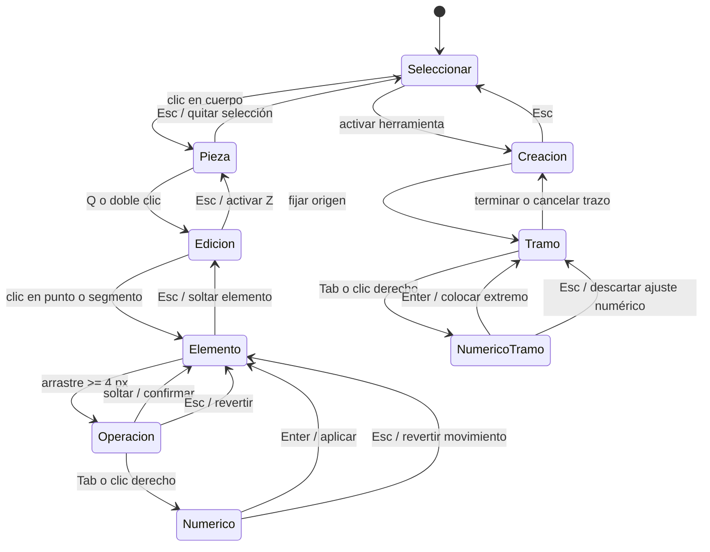

Propongo tres decisiones, en ese orden:

1. **El contexto pertenece a la operación activa y a un sujeto explícito.** Pasar el ratón por otra cosa no cambia los controles.
2. **Tab congela la operación y enfoca su distancia. El clic derecho hace exactamente lo mismo durante esa operación**, conservando el hábito de María sin abrir un menú.
3. **Una interna de N segmentos ofrece N líneas seleccionables**, con un punto en cada unión. Seleccionar una muestra su medida, no las del bloque de creación.

Son propuestas sobre el [informe](/D:/Desktop/projects/vina/docs/reports/2026-09-07-reunion-maria.md) y la [transcripción](/D:/Desktop/projects/vina/docs/reports/2026-09-07-reunion-maria-transcripcion.md), contrastadas con el código actual. No reproduje los fallos en ejecución ni modifiqué archivos. Graphify no devolvió resultados; la comprobación se hizo leyendo las fuentes.

**1. El contexto de pieza**

El código ya contiene una parte de esta idea: `cotasDelSujeto` decide qué acotar, y `ToolStrip2D` identifica herramienta y sujeto. Sin embargo, seleccionar una interna todavía solicita todas sus cotas; además, las acciones de punto y segmento siguen dependiendo del menú. Las bases están en [sujeto.ts:125](/D:/Desktop/projects/vina/src/components/PatternEditor/cotas/sujeto.ts:125), [ToolStrip2D.tsx:25](/D:/Desktop/projects/vina/src/components/PatternEditor/ToolStrip2D.tsx:25) y [actionCuration.ts:345](/D:/Desktop/projects/vina/src/components/PatternEditor/actionCuration.ts:345).

El inventario ordena intenciones dentro de cada objeto. Es una inferencia de esta sesión, no una frecuencia medida con telemetría.

| Objeto | Intención más frecuente → siguientes |
|---|---|
| Cuerpo de pieza | Seleccionarla → recolocarla → transformar su tamaño |
| Punto de contorno | Moverlo con precisión → comprobar los lados que modifica → eliminarlo |
| Borde exterior | Saber cuánto mide → modificarlo → colocar un punto sobre él |
| Segmento interno | Seleccionarlo y medirlo → cambiar su longitud → mover sus extremos |
| Unión entre internas | Agarrar ese punto → moverlo viendo qué líneas cambian |
| Asa de curva | Ajustar la dirección y curvatura |
| Cota | Leer el valor → introducir otro valor |
| Guía o enganche | Confirmar alineación o coincidencia; no cambiar de herramienta |
| Lienzo vacío | Deseleccionar → seleccionar mediante marco → iniciar un dibujo |
| Piquete, hilo, pinza, costura | Seleccionar la entidad → acceder a sus operaciones propias |

La frontera de herramientas queda así:

| Herramienta | Permiso |
|---|---|
| **Seleccionar — Z** | Seleccionar e inspeccionar; arrastrar el cuerpo recoloca la pieza completa |
| **Editar patrón — Q** | Modificar puntos y segmentos de contorno e internas |
| **Editar curva — V** | Modificar asas de curva |
| **Transformar — A** | Escalar y rotar mediante sus manejadores |
| **Herramienta de creación** | Crear su objeto; las piezas existentes sirven como anfitriones o referencias |
| **Medir — M** | Obtener medidas; ningún gesto modifica geometría |

**Precio de esta frontera:** deformar algo desde Seleccionar cuesta pulsar **Q** o hacer doble clic. Ese paso compra una diferencia observable entre seleccionar y editar. Hoy los extremos de internas se arrastran desde Seleccionar y un clic sobre ciertos puntos entra en edición: [useEditorInteractions.ts:848](/D:/Desktop/projects/vina/src/components/PatternEditor/useEditorInteractions.ts:848).

Los valores siguientes son defaults propuestos. Todos los píxeles son **CSS de pantalla**, independientes del zoom.

| Parámetro | Default | Salida o alternativa |
|---|---:|---|
| Conversión de pulsación a arrastre | Recorrido euclidiano **≥4 px** | Esc revierte el gesto |
| Blanco de punto o asa | Radio **8 px** | Acercar el zoom |
| Blanco de segmento para selección | Distancia **≤6 px** | Seleccionarlo desde el contexto de su pieza |
| Enganche durante colocación | Radio **12 px**; liberar al superar **16 px** | Mantener Ctrl suspende el enganche |
| Cierre sobre el primer nodo | Radio **12 px**, con cierre resaltado | Ctrl evita el enganche; Esc cancela |
| Doble clic | **500 ms**, separación **≤4 px** | Q entra en edición; la tira ofrece insertar punto |
| Resalte y respuesta del gesto | **≤100 ms** | Ninguna acción queda sin respuesta |
| Demora para cambiar de contexto por hover | **Nunca** | Hace falta selección o activación explícita |

Los **4 px** ya existen en [gestureConstants.ts:12](/D:/Desktop/projects/vina/src/components/PatternEditor/gestureConstants.ts:12). Los **12 px** de enganche conservan la base usada por Pluma e Internas. Seleccionar y atraer una colocación tienen radios distintos porque sirven a intenciones distintas.

La máquina tiene dos componentes: una herramienta visible y un contexto. No inferimos la herramienta a partir del objeto.

| Contexto | Entrada | Qué muestra | Salida / Esc |
|---|---|---|---|
| **Sin sujeto** | Inicio; selección vacía | Herramienta y requisitos | Esc vuelve a Z; en Z no hace nada |
| **Pieza** | Clic sobre cuerpo en Z | Identidad y acciones de pieza; sin cotas persistentes | Clic vacío o Esc quita selección |
| **Varias piezas** | Shift+clic o marco en Z | Cantidad y operaciones comunes | Esc vacía la selección |
| **Edición de pieza** | Q; doble clic desde Z | Puntos y bordes editables de esa pieza | Esc vuelve a Z conservando la pieza seleccionada |
| **Punto** | Clic sobre punto en Q | Medidas de sus vecinos inmediatos | Esc suelta el punto y conserva Q |
| **Segmento exterior/interno** | Clic sobre segmento en Q; interna también en Z | Cota del segmento y sus operaciones | Esc suelta el segmento |
| **Tamaño** | Activar A; creación de rectángulo | Manejadores y dimensiones de tamaño | Confirmar termina el ajuste; Esc cancela lo pendiente |
| **Creación** | H, G o herramienta Punto | Solo referencias y medida de esa creación | Esc cancela el paso pendiente; otro Esc cancela el trazo |
| **Medición** | M y elección de referencia | Referencias resaltadas y resultado | Esc cancela la medición pendiente; sin pendiente vuelve a Z |
| **Operación en curso** | Arrastre ≥4 px; próximo tramo en previsualización | Solo la magnitud que está cambiando | Soltar confirma, salvo que se haya congelado; Esc revierte |
| **Entrada numérica** | Tab, derecho durante operación o clic en cota editable | Campo enfocado y geometría congelada | Enter aplica; Esc descarta el ajuste pendiente |
| **Entidad especializada** | Seleccionar piquete, hilo, pinza o costura | Sus controles propios | Esc suelta la entidad |

En **Entrada numérica**, cancelar un movimiento devuelve el punto a su posición anterior al gesto. Cancelar el próximo segmento de un trazo conserva los nodos ya colocados y devuelve el control al ratón. Ningún `mouseup` posterior a Esc confirma algo cancelado.



**Un Esc consume un solo nivel.** La salida directa siempre está visible en la tira: activar Seleccionar cancela la operación pendiente y vuelve a Z. No hace falta recorrer la escalera para cambiar de herramienta.

Hay una excepción que necesita quedar escrita: finalizar una Pluma abierta no puede producir silenciosamente una pieza lista para simular. Con al menos tres puntos, Enter o doble clic presenta en la tira las decisiones **cerrar con un segmento, continuar o descartar**. El default es continuar; Esc vuelve al dibujo. Esto define la salida, sin diseñar aquí el sistema de preferencias solicitado en la reunión.

Cuando varios contextos podrían aplicar:

| Competencia | Resolución |
|---|---|
| Campo numérico frente a cualquier selección | El campo conserva sujeto y foco |
| Arrastre frente al objeto que aparece debajo | El sujeto queda fijado desde la pulsación |
| G activo frente a pieza previamente seleccionada | G manda; desaparecen las cotas externas |
| Punto frente a segmento en Q | Gana el punto dentro de 8 px |
| Asa frente a punto en V | Gana el asa visible dentro de 8 px |
| Dos segmentos elegibles | Menor distancia; empate: seleccionado, después orden de dibujo |
| Piezas superpuestas | Pieza superior; en Q se conserva la pieza en edición |
| Hover frente a selección | Hover solo anticipa; nunca sustituye el contexto seleccionado |
| Objeto eliminado, ocultado o bloqueado durante una edición | Se cancela el ajuste pendiente y desaparecen sus controles |

Para un objetivo tapado, la salida es seleccionar la pieza desde capas y entrar en Q, o elegir el elemento desde el panel de su contexto. No agrego un modificador para recorrer objetos superpuestos.

**Ubicación: la tira identifica; la cota permite actuar; el borde aloja lo secundario.**

| Superficie | Contenido y comportamiento |
|---|---|
| **Tira**, fija a **8 px** de la esquina superior izquierda del lienzo 2D | Herramienta, sujeto, operación, salida y hasta **4 acciones frecuentes**. No participa en el scroll del documento |
| **Sobre la geometría** | Una sola familia de cota negra. Su centro se coloca a **16 px** del punto medio del tramo, sobre su normal |
| **Borde derecho del lienzo** | Panel de propiedades del sujeto, abierto explícitamente desde la tira; controles secundarios y objetivos difíciles de alcanzar |

Si una cota invade un punto, asa u otra cota, prueba el otro lado del tramo y separaciones de **32 px**. Si sigue sin caber dentro de un margen de **8 px** del lienzo, el control pasa a la tira con su referencia geométrica resaltada. Nunca aparecen dos editores del mismo valor. Durante la escritura, el campo no se desplaza siguiendo el ratón.

Retirar el menú exige dar destino a sus acciones actuales:

| Acciones actuales | Destino |
|---|---|
| Mover exacto; convertir segmento | Contexto Punto/Segmento de la tira |
| Duplicar, voltear, rotar, bloquear | Contexto Pieza |
| Orden, capa, grupos, vínculos, nombre, propiedades, inspección | Panel del borde, con secciones estables |
| Operaciones de piquete, hilo, pinza y costura | Contexto de esa entidad, conservando sus restricciones |
| Pegar, pegar en espejo, ajustar vista | Contexto Sin sujeto y atajos existentes |

El inventario está en [actionCuration.ts:162](/D:/Desktop/projects/vina/src/components/PatternEditor/actionCuration.ts:162). Una acción sin destino impide declarar sustituido el menú.

**2. El control numérico antes de soltar**

**Gesto principal: orientar → Tab → escribir distancia → Enter.**  
**Acceso para María: orientar → clic derecho → escribir distancia → Enter.**

El derecho **enfoca la cota que ya acompaña la operación**. No abre una lista de comandos, un diálogo ni una segunda superficie flotante.

Esto extiende una capacidad existente: Pluma e Internas ya congelan el próximo tramo con Tab, y el editor enfoca su cota. Véanse [usePenTool.ts:284](/D:/Desktop/projects/vina/src/components/PatternEditor/usePenTool.ts:284), [usePolyPenTool.ts:278](/D:/Desktop/projects/vina/src/components/PatternEditor/usePolyPenTool.ts:278) y [PatternEditor.tsx:801](/D:/Desktop/projects/vina/src/components/PatternEditor/PatternEditor.tsx:801).

La magnitud depende de la intención:

| Operación | Origen y dirección | Campo inicial | Enter |
|---|---|---|---|
| Mover punto en Q | Posición anterior al arrastre → dirección trazada | **Desplazamiento** | Mueve exactamente esa distancia |
| Mover varios puntos/segmentos en Q | Vector común desde sus posiciones iniciales | **Desplazamiento** | Aplica el mismo vector a todos |
| Próximo tramo recto en H/G | Último nodo → cursor | **Longitud** | Coloca el siguiente extremo |
| Insertar Punto sobre un borde | Extremo de referencia → recorrido sobre ese borde | **Distancia sobre el borde** | Inserta el punto |
| Cambiar longitud de segmento existente | Extremo fijo → extremo móvil | **Longitud** | Mueve el extremo móvil |
| Ajustar un asa | Ancla → dirección del asa | **Longitud del asa** | Ajusta el asa, sin presentarla como longitud de curva |

Para Punto, el default de referencia es el extremo del borde más cercano a la pulsación; un empate usa el inicio del borde. Queda marcado desde el principio. La tira permite cambiar al otro extremo. La referencia no cambia mientras arrastras.

**Punto conserva su significado actual: insertar sobre un borde.** En una curva, esos 50 mm se recorren sobre la curva; no se miden en línea recta. El comportamiento actual ya fija el borde en la pulsación: [usePointTool.ts:208](/D:/Desktop/projects/vina/src/components/PatternEditor/usePointTool.ts:208).

La secuencia durante un arrastre queda cerrada así:

| Evento | Resultado |
|---|---|
| Cruzar 4 px | Empieza la previsualización; aparece su medida |
| Tab o pulsar derecho | Congela sujeto, origen y dirección; selecciona el texto de distancia |
| Soltar izquierdo después de congelar | **No confirma** |
| Mover el ratón mientras escribes | **No altera la geometría** |
| Enter o control visible de aplicar | Confirma una sola operación |
| Esc o control visible de cancelar | Revierte lo pendiente |
| Clic fuera del campo | Cancela el ajuste; ese clic se consume y no inicia otro gesto |
| Pérdida de ventana o `pointercancel` | Cancela la operación pendiente |

**El ángulo es opcional de verdad.**

| Situación | Default | Escape hatch |
|---|---|---|
| Ya existe dirección del ratón | Se conserva con su precisión interna; solo se enfoca distancia | Tab desde distancia revela y enfoca ángulo |
| María escribe solo `500` | Enter coloca a 500 mm en esa dirección | Esc cancela |
| María quiere cambiar a `−90°` | Introduce `500`, Tab, `−90`, Enter | Volver a distancia con Shift+Tab |
| Todavía no existe dirección fiable — recorrido <4 px | La distancia puede introducirse, pero no se inventa un rumbo | Orientar ≥4 px y hacer clic; también puede introducir un ángulo voluntariamente |
| Punto restringido a borde | El borde determina el recorrido; no aparece ángulo | Cambiar el extremo de referencia |

Después de confirmar un tramo, el siguiente vuelve a seguir al ratón. No hereda una longitud ni un ángulo bloqueados sin que María los vuelva a pedir.

Los ángulos mantienen la convención que ya usa Vina: **0° derecha, +90° arriba, −90° abajo**, respecto al lienzo, incluso si la pieza está girada. Está expresada en [polyPenGeometry.ts:117](/D:/Desktop/projects/vina/src/components/PatternEditor/polyPenGeometry.ts:117).

La prioridad durante una colocación es:

**Valor numérico explícito → ángulo explícito → Shift mantenido → enganche → ratón libre.**

- Shift restringe direcciones rectilíneas a múltiplos de **45°**, solo mientras se mantiene.
- Ctrl suspende el enganche, sin desactivar una restricción angular explícita.
- Un imán cercano a 499,8 mm no corrige una entrada de 500 mm.
- En campos se aceptan coma y punto decimal. Longitudes nuevas: mínimo **0,1 mm**; desplazamiento cero: operación sin cambio. Un valor inválido permanece editable y nunca se recorta silenciosamente.

**El precio del hábito de CLO:** conservando el derecho, María aprende **0 botones nuevos** para pedir precisión y **1 ubicación nueva** para escribir: la cota, en lugar del diálogo. Tab es una alternativa, no una obligación. No prometo segundos ahorrados sin probarlo; la ganancia defendible es conservar la referencia geométrica y permitir terminar rellenando un solo campo.

También cambia un hábito actual de Vina: el derecho durante H/G hoy se suprime. En esas operaciones pasaría a tener una respuesta útil. En Rectángulo, Coser, Piquete y Margen conserva su cancelación actual; no le asigno precisión a herramientas fuera de este encargo.

**3. La granularidad de la línea interna**

**La unidad seleccionable es el tramo entre dos nodos consecutivos.** El gesto que creó varios tramos no forma un grupo de selección.

```text
A ───────── B ───────── C ───────── D
      AB          BC          CD

clic en BC → BC
clic en B, con Q → B
Shift+clic en CD → BC + CD
```

Hay **tres líneas seleccionables y cuatro puntos**, aunque se hayan dibujado de una vez. Esto no exige decidir aquí cómo se serializan: el modelo actual contiene un `path`, pero la selección solo conserva `pieceId + lineId`; esa selección resulta demasiado gruesa. [types.ts:301](/D:/Desktop/projects/vina/src/types/types.ts:301), [editorSlice.ts:118](/D:/Desktop/projects/vina/src/store/editorSlice.ts:118).

| Intención | Default | Alternativa / salida |
|---|---|---|
| Seleccionar una interna | Clic selecciona el segmento tocado | Shift+clic añade o quita segmentos |
| Seleccionar todas las internas de la pieza | Acción explícita en su contexto | Esc vacía esa selección |
| Seleccionar un punto intermedio | Q + clic en ese punto | Esc vuelve a edición de pieza |
| Mover BC | Q + arrastre traslada B y C | Esc revierte |
| Cambiar longitud de BC | B fijo; C se mueve siguiendo BC | Control de extremo fijo permite invertirlo |
| Borrar BC | Supr elimina solo BC | Deshacer recupera BC |
| Cruzar dos líneas | El cruce no crea una unión automáticamente | Insertar o unir puntos requiere una acción explícita |

Un nodo compartido sigue siendo compartido: mover B modifica AB y BC. La previsualización resalta ambos como afectados, pero **no convierte AB en seleccionado**.

Borrar un segmento no une automáticamente los extremos que deja separados. Tampoco suprime otras líneas de su antigua tanda de creación.

Las cotas son estas:

| Contexto | Cotas visibles por defecto |
|---|---|
| Segmento BC seleccionado | **Una longitud**, sobre BC |
| Ángulo solicitado | Se añade dentro de la misma cota compacta |
| Punto B seleccionado | Longitudes de AB y BC; ninguna de CD |
| B arrastrándose | Desplazamiento desde B original; desaparecen temporalmente las cotas vecinas |
| Varios segmentos seleccionados | Cantidad y longitud total en la tira; cota del último segmento seleccionado |
| Todas las internas seleccionadas | Cantidad y total en la tira; ninguna explosión de etiquetas |
| G dibujando | Solo el próximo tramo y el enganche activo |
| Medir sobre una interna | Longitud del segmento tocado |
| Curva seleccionada | Longitud recorrida de esa curva, no distancia entre extremos |

Al editar una cota vecina de un punto, se mueve **el punto seleccionado**; el vecino queda fijo. Si la longitud es de una curva, queda de lectura hasta definir cómo debe deformarse al cambiarla. No presento una longitud de cuerda como longitud de curva.

Hoy `cotasDeLineaInterna` recorre los segmentos del `path` y genera sus cotas conjuntamente. El cambio de selección debe acompañarse de ese filtro: [cotas.ts:251](/D:/Desktop/projects/vina/src/components/PatternEditor/cotas/cotas.ts:251).

**4. La matriz de gramática**

`S` = Seleccionar Z. `E` = Editar patrón Q. `—` = sin operación propia. Los puntos no son blancos editables en S; manda el cuerpo o segmento que hay debajo.

En reposo, **derecho** selecciona el objetivo con las mismas reglas que izquierdo y lleva el foco a su contexto en la tira. No ejecuta una operación destructiva ni abre un menú.

| Objeto | Clic | Doble clic | Arrastre ≥4 px | Modificador + clic | Modificador + arrastre | Derecho | Hover |
|---|---|---|---|---|---|---|---|
| Cuerpo de pieza | S: seleccionar. E: activar esa pieza para edición | S: entrar en Q. E: — | S: recolocar pieza. E: marco de puntos | Shift: añadir/quitar pieza en S | Shift en S: recolocar sobre dirección a 45°. En E: añadir puntos con marco | Seleccionar y enfocar contexto Pieza | Anticipar pieza |
| Punto de contorno | S: pieza. E: seleccionar punto | S: entrar en Q sobre punto. E: — | S: pieza. E: mover punto | Shift en E: añadir/quitar punto | Shift en E: mover a 45° | E: seleccionar y enfocar contexto Punto | E: anticipar punto |
| Borde exterior | S: pieza. E: seleccionar segmento | S: entrar en Q. E: insertar punto | S: pieza. E: trasladar extremos | Shift en E: añadir/quitar segmento | Shift en E: trasladar a 45° | Enfocar contexto correspondiente | E: anticipar segmento |
| Segmento interno | Seleccionar solo ese segmento | S: entrar en Q. E: insertar punto | S: no deforma; indica acceso Q. E: trasladar extremos | Shift: añadir/quitar segmento | E + Shift: trasladar a 45° | Enfocar contexto Interna | Anticipar solo ese tramo |
| Punto intermedio interno | S: segmento debajo. E: seleccionar nodo | S: entrar en Q sobre nodo. E: — | S: no deforma. E: mover nodo compartido | Shift en E: añadir/quitar nodo | E + Shift: mover a 45° | E: enfocar contexto Punto | E: resaltar nodo y líneas afectadas |
| Asa visible en V | Seleccionar asa | — | Ajustar asa | — | Shift: dirección a 45° | Enfocar control del asa | Cursor de ajuste |
| Manejador en A | Seleccionar manejador | — | Escalar o rotar | — | Shift conserva sus restricciones actuales | Enfocar su control | Cursor de escala o rotación |
| Cota | E: editar. S/M: leer | E: igual que clic; dentro del campo selecciona texto | E: ajuste numérico por arrastre | — | Shift: paso ×10; Alt: paso ×0,1 | E: enfocar valor. S/M: — | Identificar la geometría medida |
| Guía de referencia | —; pasa al blanco inferior | — | — | Ctrl: suspender enganche | Ctrl: suspender enganche | Pasa al blanco inferior | Confirmar alineación |
| Lienzo vacío | S: quitar selección. E: soltar elementos | — | S: marco de piezas. E: marco de puntos | Shift: conservar selección | Shift: marco aditivo | Enfocar contexto Sin sujeto | Sin resalte |

La multiselección en Q admite puntos y segmentos; moverla aplica el vector una sola vez a cada nodo implicado. En S, si se seleccionan una pieza y una interna suya, la pieza representa ese contenido: no se opera dos veces sobre él.

El doble clic se interpreta según la herramienta que estaba activa al comenzar la secuencia. Entrar en Q mediante doble clic **no inserta además un punto**.

Para las herramientas de creación y medida, esta matriz sustituye a la anterior sobre geometría y lienzo. Los controles de interfaz conservan sus propios gestos.

| Herramienta / blanco | Clic | Doble clic | Arrastre ≥4 px | Modificador + clic | Modificador + arrastre | Derecho | Hover |
|---|---|---|---|---|---|---|---|
| H/G: ubicación válida | Colocar nodo | Finalizar; H aplica la regla de cierre | Crear asas Bézier del nodo | Ctrl: colocar sin imán; Shift: dirección a 45° | Shift: orientar asa a 45° | Congelar y enfocar la magnitud activa | Próximo tramo y enganche |
| G: ubicación sin pieza anfitriona | No crea; señala requisito | — | — | — | — | — | Indica ubicación no válida |
| Punto: borde | Insertar en la ubicación indicada | Un solo punto, sin duplicado | Elegir posición sobre ese borde | Ctrl: ignorar enganches opcionales | Ctrl: ignorar enganches opcionales | Congelar y enfocar distancia | Borde, origen y posición previstos |
| M: segmento | Medir ese segmento | Misma medición, sin duplicarla | — | — | — | Enfocar contexto Medición | Resaltar tramo completo |
| M: punto o vacío | Primer clic fija origen; segundo fija destino | Sin acción adicional | — | Ctrl: omitir enganche | — | Cancelar referencia pendiente | Mostrar el punto exacto que se tomaría |
| Rectángulo: lienzo | Primer clic fija esquina; segundo fija esquina opuesta | Sin creación adicional | Crear rectángulo | Shift: proporción cuadrada | Shift: proporción cuadrada | Cancelar creación | Previsualizar tamaño |

El ajuste numérico nunca cambia lo que significa un arrastre de Pluma: si estás creando un asa, controla **el asa**. Para fijar la longitud del siguiente tramo usas su previsualización entre nodos.

**5. Auditoría contra los bindings actuales**

| Binding o comportamiento leído | Colisión | Resolución propuesta |
|---|---|---|
| **Espacio / Shift+Espacio**: simulación | Convención Space-pan | Se conservan. No introducir Space-pan |
| **Botón central**: pan | Interrumpir dibujo o confirmar por accidente | Pan temporal; conserva herramienta y borrador. Soltar central no coloca nodos |
| Rueda: zoom con ratón; pan con trackpad; Ctrl/Meta+rueda: zoom | Campo numérico podría cambiar de valor al navegar | Conservar navegación; rueda nunca edita la cifra |
| **Z/Q/V/A/H/S/E/G/M** | Crear un modo nuevo o cambiar teclas conocidas | Conservar selección, edición, curva, transformación, pluma, rectángulo, elipse, interna y medida |
| **Tab**: cota o próximo tramo | Añadir otro gesto para precisión | Extender el existente a movimiento y Punto |
| **Tab / Shift+Tab dentro del campo** | Navegación frente a colocación | Cambian de campo; nunca colocan un punto |
| **Enter**: terminar trazo | Confirmar número podría finalizar todo | Con campo enfocado aplica solo su operación; desde el lienzo termina el trazo |
| **Esc** local y global | Cancelar y deseleccionar con la misma pulsación | Consume un solo nivel |
| **Shift+clic**: selección múltiple | Shift también restringe dirección | Clic añade/quita; después del umbral de arrastre restringe movimiento |
| **Doble clic en Q**: insertar punto | Doble clic para entrar en edición | La herramienta al comienzo de la secuencia decide |
| **Supr/Retroceso**: selección o último nodo del trazo | Borrar pieza al editar una cifra o interna | Prioridad: texto → trazo activo → subelemento → pieza |
| **Ctrl+A**: todas las piezas visibles | Podría convertirse silenciosamente en “todas las internas” | Conservar selección global de piezas y mostrar Z; las internas tienen acción explícita |
| **Ctrl+Z / Ctrl+Shift+Z / Ctrl+Y** | Deshacer texto frente a geometría | Dentro del campo: texto. Fuera: historial; una operación confirmada es un paso |
| **Ctrl+C/V/R/D** | Operar sobre la pieza padre de un segmento | Nunca caer al padre; habilitar solo operaciones que soporten el sujeto seleccionado |
| Derecho durante Rectángulo/Coser/Piquete/Margen | Nuevo acceso numérico rompería cancelación | Conservar cancelación en esas herramientas |
| Derecho durante Pluma/Internas | Hoy se suprime | Enfocar directamente la magnitud activa |
| Etiquetas `R`, `H`, `V` de acciones del menú | Compiten con Desplazar contorno, Pluma y Editar curva | No convertir esas etiquetas en nuevos bindings; mostrar solo el atajo efectivo |
| Resto de teclas registradas, incluidas 3D | Captura excesiva de teclado | Sin cambios; se respeta el contexto de foco |

Las fuentes de esta auditoría son el [registro de atajos](/D:/Desktop/projects/vina/src/shortcuts/defaults.ts:10), la [navegación por rueda](/D:/Desktop/projects/vina/src/input/wheelIntents.ts:34), el [enrutamiento de teclado](/D:/Desktop/projects/vina/src/components/PatternEditor/useEditorInteractions.ts:492), el [doble clic de Q](/D:/Desktop/projects/vina/src/components/PatternEditor/useEditPattern.ts:713), el [campo de cota](/D:/Desktop/projects/vina/src/components/PatternEditor/cotas/CotaChip.tsx:159) y el [derecho actual](/D:/Desktop/projects/vina/src/components/PatternEditor/PatternEditor.tsx:421).

Los atajos personalizados tampoco se presuponen: la tira ya consulta el binding efectivo. Punto no recibe aquí una tecla inventada.

**6. Chequeo de convenciones**

| Programa | Convención comprobada | Qué tomo y qué cuesta desviarse |
|---|---|---|
| **Illustrator** | Selection opera objetos; Direct Selection opera puntos y segmentos. Shift añade selección | Tomo la separación entre pieza y geometría. Conservo las teclas de Vina, porque cambiarlas impondría otro aprendizaje. [Adobe](https://helpx.adobe.com/illustrator/desktop/manage-objects/select-objects/select-transform-objects-selection-tools.html) |
| **Figma** | Enter o doble clic permiten entrar en edición vectorial; los controles disponibles cambian con esa edición | Tomo la entrada explícita y la edición visible. No tomo Enter como acceso global porque Vina ya lo necesita para terminar trazos. [Edición vectorial](https://help.figma.com/hc/en-us/articles/360039957634-Edit-vector-layers), [doble clic](https://help.figma.com/hc/en-us/articles/31130310976663-FD4B-Use-vector-edit-mode-to-modify-shapes) |
| **CLO3D** | Derecho durante movimiento de punto o línea abre Precision Move; Shift selecciona varios elementos | Conservo el momento y el botón. Cambio el destino del foco a la cota. Es exactamente el hábito que María pide conservar. [Guía oficial, p. 41](https://support.clo3d.com/hc/en-us/article_attachments/48293801440281) |
| **Rhino** | Tab fija la dirección ya señalada; las restricciones de distancia y ángulo pueden utilizarse por separado | Tomo orientación con ratón y distancia numérica independiente. En Vina, el siguiente Tab navega al ángulo; no activa el segundo comportamiento circular de Rhino. [McNeel](https://docs.mcneel.com/rhino/8/help/en-us/user_interface/accurate_modeling.htm) |
| **Seamly2D** | Su documentación comunitaria describe elegir punto base, aproximar posición y precisar distancia/ángulo; distingue distancia sobre una línea | Tomo la referencia explícita y la separación entre recorrido y dirección libre. Evito obligar a completar un diálogo de dos magnitudes. Fuente histórica de 2022; no la generalizo a toda versión de Valentina. [Documentación del proyecto](https://forum.seamly.io/t/about-point-toolset/6570) |

Ninguna de estas referencias justifica por sí sola mis radios de selección. Esos números son defaults de la propuesta, apoyados donde corresponde en los valores existentes de Vina.

**7. Disclosure progresivo**

| Momento | Lo que encuentra María | Salida |
|---|---|---|
| **Primer día** | Herramienta visible, sujeto resaltado, una medida y acceso visible a editar/cancelar | Seleccionar siempre accesible |
| **Primer ajuste exacto** | Orienta con ratón; derecho enfoca distancia; Enter aplica | Esc restaura |
| **Cuando necesita ángulo** | Activa el control angular o llega con Tab | Puede confirmar distancia sin visitarlo |
| **Trabajo repetido** | Tab sustituye el derecho; Shift restringe; Ctrl suspende enganche | Soltar modificador restaura |
| **Edición de varias líneas** | Shift+clic y operación común, con una sola magnitud de desplazamiento | Esc suelta selección |
| **Objetivo superpuesto o acción infrecuente** | Panel del borde abierto explícitamente | Cerrar panel conserva sujeto |

Solo incorporo quasimodos de restricción y navegación: **Shift, Ctrl y botón central**. No agrego herramientas temporales por mantener letras pulsadas: ampliarían el vocabulario motor sin resolver estas tres quejas.

**8. El Corte**

La propuesta queda limitada a contexto, precisión durante el gesto y selección de internas.

- **No rediseño la paleta**, sus categorías ni el sistema de atajos.
- **No determino una migración de `InternalLine`**. Exijo segmentos seleccionables y nodos coherentes; el almacenamiento corresponde a ingeniería.
- **No unifico los hit-tests de todo el CAD**. Fijo el contrato de estas interacciones. El propio [snapIndex.ts:16](/D:/Desktop/projects/vina/src/components/PatternEditor/snapIndex.ts:16) distingue su reutilización limitada de una unificación general.
- **No aplico la fragmentación genérica a pinzas, piquetes, hilo o costuras**: tienen semántica propia.
- **No diseño un solucionador de longitud de curvas**, un sistema de restricciones persistentes ni puntos libres paramétricos.
- **No doy por resueltos el parpadeo, overscroll o conversión defectuosa a curva** mediante esta gramática.

La comprobación con María debe terminar en tres acciones observables: **mover un punto 10 mm sin calcular lados; orientar una interna y darle 500 mm sin escribir ángulo; seleccionar BC sin que aparezcan las cotas de AB y CD**. Cada una debe admitir Esc antes de confirmar y un solo Deshacer después.

La mano aprende una vez. Hay que cuidar esa lección.