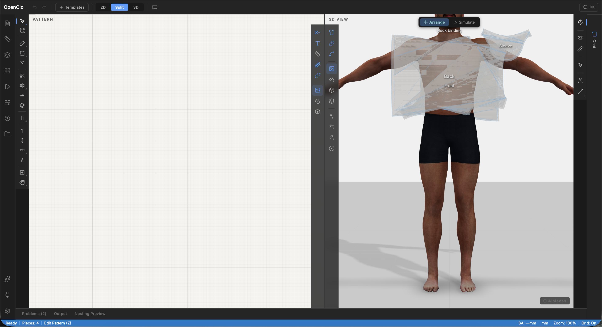

# OpenClo UI Polish Spec — For UX/UI Design Team

> **Date:** 2026-03-05
> **Target:** Production-quality visual polish across all interface components
> **Reference app:** CLO3D (see screenshots below)
> **Stack:** React 18, Three.js (R3F), CSS custom properties, Lucide icons, Inter font

---

## 1. Current State Overview

OpenClo is a browser-based garment CAD with a VS Code-inspired layout. The interface is functional but visually rough — it needs a polish pass to reach professional-grade quality comparable to CLO3D, Browzwear, or Figma.

### Current Screenshot



### Layout Structure (left to right)

```
┌──────────────────────────────────────────────────────────────────┐
│  Workspace Toolbar (44px)  — logo, undo/redo, view toggle       │
├────┬──────┬────┬─────────────────┬──────────────────────┬────┬───┤
│    │      │    │                 │                      │    │   │
│ A  │  S   │ T  │   2D Pattern    │    3D Viewport       │ T  │ P │
│ c  │  i   │ 2  │   Editor        │                      │ 3  │ r │
│ t  │  d   │ D  │                 │   [DisplayBar3D]     │ D  │ o │
│ i  │  e   │    │  [DisplayBar2D] │                      │    │ p │
│ v  │  b   │    │                 │                      │    │ s │
│ i  │  a   │    │                 │                      │    │   │
│ t  │  r   │    │                 │                      │    │   │
│ y  │      │    │                 │                      │    │   │
├────┴──────┴────┴─────────────────┴──────────────────────┴────┴───┤
│  Status Bar (22px)  — tool, pieces, zoom, units                  │
└──────────────────────────────────────────────────────────────────┘
```

**Dimensions:**
| Component | Width/Height | CSS Variable |
|-----------|-------------|--------------|
| Workspace Toolbar | 44px height | `--toolbar-height` |
| Activity Bar | 48px width | `--activitybar-width` |
| Sidebar | 0–280px width | `--sidebar-width` |
| Toolbar 2D | 42px width | `--toolbar2d-width` |
| Toolbar 3D | 42px width | `--toolbar2d-width` |
| DisplayBar 2D | 36px width | — (floating pill) |
| DisplayBar 3D | 36px width | — (floating pill) |
| Properties Panel | 40–280px width | `--panel-width` |
| Bottom Panel | 0–280px height | `--panel-height` |
| Status Bar | 22px height | `--statusbar-height` |
| Viewport Divider | 4px width | `--divider-width` |

---

## 2. Design Tokens (Current)

### Colors

```css
/* Backgrounds */
--bg-primary:     #1a1a1a    /* Main background */
--bg-secondary:   #242424    /* Toolbars, panels */
--bg-panel:       #2a2a2a    /* Panel backgrounds */
--bg-canvas:      #f5f3f0    /* 2D canvas (light) */

/* Text */
--text-primary:   #ffffff
--text-secondary: #b0b0b0
--text-muted:     #6b6b6b

/* Accent */
--accent:         #4a9eff    /* Primary blue */
--accent-hover:   #6bb3ff
--accent-dim:     rgba(74, 158, 255, 0.15)

/* Semantic */
--selected:       #ffd700    /* Gold selection */
--seam-color:     #ff6b6b    /* Red seam lines */
--grainline-color:#6bff6b    /* Green grain */
--color-error:    #ef4444
--color-warning:  #cca700
--color-success:  #10b981
--color-copilot:  #8b5cf6    /* Purple copilot */

/* Borders */
--border:         #3a3a3a
--border-light:   #4a4a4a

/* Interactions */
--btn-bg-hover:   rgba(255, 255, 255, 0.06)
--btn-bg-active:  rgba(255, 255, 255, 0.12)
```

### Typography

```css
font-family: 'Inter', -apple-system, BlinkMacSystemFont, sans-serif;
font-size: 13px;              /* Base */
--font-size-small: 11px;      /* Labels, tooltips, status bar */
/* Weights: 400, 500, 600, 700 */
```

### Icons

- **Library:** lucide-react v0.575.0
- **Standard sizes:** 16px (small), 18px (toolbar buttons), 20px (activity bar)

---

## 3. Areas Requiring Polish

### 3.1 Workspace Toolbar (top bar)

**Current issues:**
- View mode toggle (2D / Split / 3D) looks like a prototype — plain buttons with no visual grouping
- Undo/Redo buttons lack visual hierarchy
- Logo area has no brand presence
- Template picker button ("+ Templates") looks generic
- Search and copilot toggle buttons feel detached

**Polish direction:**
- View mode toggle should be a segmented control with smooth active-state transition (like Figma's zoom controls)
- Group related actions visually (undo/redo as a pair, view toggle as a unit)
- Add subtle dividers between action groups
- Consistent icon+label style or icon-only with tooltips — pick one, don't mix
- Consider removing the search icon if CommandPalette (Cmd+K) is the primary discovery mechanism

---

### 3.2 Activity Bar (left edge, 48px)

**Current issues:**
- Icons are evenly spaced with no visual grouping — looks flat
- Active indicator (2px blue bar) is subtle and hard to notice
- Too many items (11+) — cognitive overload for a sidebar nav
- No visual distinction between primary actions (Pattern, Measurements) and settings

**Polish direction:**
- Group icons into logical sections with subtle separators (top: creation, middle: analysis, bottom: system)
- Active state needs more contrast — consider a background highlight in addition to the bar indicator
- Reduce icon count or use progressive disclosure (show 5–6 primary, group rest under "more")
- Hover state should show a tooltip with label (currently might already, verify consistency)

---

### 3.3 Toolbar 2D (left of 2D editor, 42px)

**Current issues:**
- Very tall — 16+ tool groups stacked vertically, extends beyond viewport on smaller screens
- Visual separators between groups are thin and easy to miss
- Sub-tool strips (long-press) work but feel janky — no animation feedback on press-hold
- Active tool indicator (3px left bar) competes with similar indicators on activity bar
- Tool icons are dense and hard to distinguish at a glance

**Polish direction:**
- Consider collapsible groups or a scrolling indicator (CLO3D uses a compact strip with overflow)
- Make long-press affordance discoverable (small triangle indicator in corner of tools with sub-tools, like Photoshop)
- Active tool: use a filled background instead of just a left bar — more visible
- Add icon labels on hover (tooltip) if not already consistent
- Consider reducing button height from 30px to 28px to fit more tools

---

### 3.4 Toolbar 3D (right of 3D editor, 42px)

**Current issues:**
- Mirrors Toolbar2D style but has fewer tools — feels sparse
- Flyout sub-menus extend left, could overlap with viewport content
- Same visual issues as Toolbar2D (separator visibility, active indicator)

**Polish direction:**
- Match any changes made to Toolbar2D for consistency
- Flyout menus should have a subtle shadow and arrow indicator pointing to parent tool
- Consider if this really needs to be a full-height bar vs. a floating pill (like DisplayBar3D)

---

### 3.5 DisplayBar 2D (floating pill, right side of 2D viewport)

**Current state:** CLO3D-style floating pill, 36px wide, vertically centered, semi-transparent
- 5 visibility toggles + 3 render mode buttons
- Rounded corners (10px), backdrop blur

**Polish direction:**
- Good foundation — visually consistent with CLO3D reference
- Consider grouping render modes more distinctly (e.g., a recessed background behind the mode group)
- Active toggle icons should have a glow or badge, not just color change — hard to see at a glance
- Maybe add a subtle header/label for each group (tiny 8px text: "DISPLAY" / "RENDER")

---

### 3.6 DisplayBar 3D (floating pill, left side of 3D viewport)

**Current state:** Same style as DisplayBar2D but on the left. Has 3 sections:
- 3 visibility toggles (Garment, Seamlines, Internal Lines)
- 4 surface modes (Textured, Translucent, Mesh, Thick)
- 4 fit map modes (Stress, Strain, Fit, Pressure)

**Polish direction:**
- 11 buttons in one pill is tall — consider splitting into 2 separate pills (display + analysis) stacked vertically with a gap
- Same active-state improvements as DisplayBar2D
- Fit map modes could use color-coded icons (stress=red, strain=orange, fit=green, pressure=blue)

---

### 3.7 Properties Panel (right side, collapsible)

**Current issues:**
- Collapsed state (40px icon strip) looks like another toolbar — confusing with Toolbar3D next to it
- Section headers use tiny uppercase text that's hard to read
- Slider controls are unstyled browser defaults
- Toggle buttons lack consistent styling
- Panel feels dense — needs more whitespace

**Polish direction:**
- Collapsed state: use a single expand arrow, not a full icon strip (or make icons distinct from toolbar icons)
- Section headers: slightly larger (11px → 12px), with a chevron toggle and count badge
- Custom slider styling matching the accent color
- Consistent spacing: 12px between sections, 8px between controls within a section
- Consider a card-based layout for each section instead of flat list

---

### 3.8 2D Pattern Canvas

**Current issues:**
- Light background (#f5f3f0) with subtle grid — good foundation
- Piece rendering could use stronger outlines
- Selection highlight (gold) works but no selection handles/grips visible
- No visual feedback for snapping (snap-to-grid, snap-to-point)
- Viewport label "PATTERN" overlaps with toolbar area

**Polish direction:**
- Add selection handles (small squares at corners and midpoints of selected piece edges)
- Snap feedback: show a subtle cross or highlight when snapping activates
- Grid should fade at edges for a more polished look
- Consider a subtle vignette or shadow at canvas edges to create depth
- Piece fill should respond more clearly to render mode (wireframe should show just outlines)

---

### 3.9 3D Viewport

**Current issues:**
- Avatar model rendering is decent but ground plane is plain white
- Pattern pieces floating on avatar look flat — no shadow or ambient occlusion on pieces
- "3D VIEW" label + "Arrange / Simulate" toggle look like a prototype overlay
- Grid is visible but lacks the polish of CLO3D's infinite floor plane
- Contact shadows are minimal

**Polish direction:**
- Ground plane: gradient or studio-style environment (CLO3D uses a neutral gray gradient floor)
- Piece rendering: add subtle edge darkening or ambient occlusion to pieces on avatar
- Mode toggle (Arrange/Simulate): restyle as a proper segmented control, positioned consistently (top-center or integrated into ToolOptionsBar)
- Camera controls: add visible zoom/orbit/pan indicator or widget
- Loading state: add a spinner or skeleton when pieces are computing positions
- Consider an HDRI environment map for more realistic fabric rendering

---

### 3.10 Bottom Panel

**Current issues:**
- Tab bar looks like a browser tab bar — inconsistent with app styling
- "Problems (2)" badge is plain text, not visually distinct
- Panel resize handle is invisible until hover
- CopilotPanel inside bottom panel has its own styling that conflicts

**Polish direction:**
- Tab bar: match VS Code styling more closely (underline active tab, muted inactive)
- Badge for problems count: use a small pill/chip with error color
- Resize handle: show a subtle dots/grip pattern (like Figma's panel handles)
- Consider whether CopilotPanel should always be in the bottom panel or have its own docking area

---

### 3.11 Status Bar

**Current issues:**
- Blue background (#007acc) is very VS Code — consider whether this fits OpenClo's brand
- Information density is good but items lack visual separation
- Status dots (solver health) are hard to read at 6px

**Polish direction:**
- Background: consider a darker, more neutral tone that blends with the app (or keep blue as brand accent)
- Add micro-icons next to text labels for quick scanning
- Increase status dot to 8px with a subtle ring/glow for better visibility
- Group left items (tool info) and right items (system status) more distinctly

---

### 3.12 Workspace Divider

**Current issues:**
- 4px divider is functional but invisible until hovered
- No grab indicator

**Polish direction:**
- Show a subtle center dot or line pattern in the divider (3 small dots vertically centered)
- On hover: accent color + slightly wider hit area is already good
- Consider a subtle shadow on the 3D side of the divider to create depth between panels

---

## 4. Cross-Cutting Concerns

### 4.1 Visual Consistency

- **Toolbar widths:** Toolbar2D (42px), Toolbar3D (42px), DisplayBars (36px), ActivityBar (48px) — 4 different widths for similar components. Consider standardizing.
- **Active states:** Three different active indicators in use — left bar (Toolbar2D), right bar (Toolbar3D), accent color (DisplayBars). Unify to one or two patterns.
- **Border radius:** Varies from 4px (tooltips) to 6px (buttons) to 10px (floating pills). Establish a scale: 4px small, 8px medium, 12px large.
- **Opacity patterns:** Many different opacity values used for transparency. Standardize to a 3-4 level scale.

### 4.2 Spacing System

Currently ad-hoc. Propose a 4px grid system:
- **4px:** Minimum gap, inline spacing
- **8px:** Standard gap between related items
- **12px:** Section padding
- **16px:** Panel padding
- **24px:** Large section separation

### 4.3 Elevation / Depth

No consistent shadow or elevation system. Propose:
- **Level 0:** Flush (toolbars, status bar)
- **Level 1:** Subtle shadow (floating pills, tooltips) — `0 2px 8px rgba(0,0,0,0.3)`
- **Level 2:** Medium shadow (dropdowns, flyouts) — `0 4px 16px rgba(0,0,0,0.4)`
- **Level 3:** Modal shadow (dialogs, command palette) — `0 8px 32px rgba(0,0,0,0.5)`

### 4.4 Animation & Transitions

Current: 0.12s–0.25s various easing. Standardize:
- **Micro interactions** (hover, active): `0.1s ease`
- **Panel slide/resize:** `0.2s cubic-bezier(0.4, 0, 0.2, 1)`
- **Modal appear:** `0.15s ease-out`

### 4.5 Responsive Breakpoints

| Class | Width | Layout |
|-------|-------|--------|
| mobile | < 768px | Chat-only |
| compact | < 1200px | Single viewport, no split |
| medium | < 1600px | Split 40/60 |
| large | >= 1600px | Split 50/50 |

---

## 5. Component Reference

### All UI Components

| Component | Location | Type | Notes |
|-----------|----------|------|-------|
| Workspace | `src/components/Workspace/` | Layout | Main container |
| ActivityBar | `src/components/ActivityBar/` | Navigation | Left icon menu |
| Sidebar | `src/components/Sidebar/` | Panel | Collapsible left panel |
| Toolbar2D | `src/components/Toolbar2D/` | Toolbar | 2D editor tools |
| Toolbar3D | `src/components/Toolbar3D/` | Toolbar | 3D editor tools |
| ToolOptionsBar | `src/components/Toolbar3D/ToolOptionsBar.tsx` | Toolbar | Context options |
| DisplayBar2D | `src/components/DisplayBar2D/` | Overlay | Floating visibility toggles |
| DisplayBar3D | `src/components/DisplayBar3D/` | Overlay | Floating visibility/surface toggles |
| PatternEditor | `src/components/PatternEditor/` | Canvas | 2D SVG editor |
| Viewport3D | `src/components/Viewport3D/` | Canvas | 3D WebGL viewport |
| PropertiesPanel | `src/components/PropertiesPanel/` | Panel | Right sidebar |
| AvatarPanel | `src/components/Viewport3D/AvatarPanel.tsx` | Panel | Avatar/pose editor |
| BottomPanel | `src/components/BottomPanel/` | Panel | Bottom dock |
| CopilotPanel | `src/components/CopilotPanel/` | Panel | AI chat |
| StatusBar | `src/components/StatusBar/` | Bar | Bottom status |
| CommandPalette | `src/components/CommandPalette/` | Modal | Cmd+K search |
| TemplateLibrary | `src/components/TemplateLibrary/` | Modal | Pattern templates |
| ShortcutHelp | `src/components/ShortcutHelp/` | Modal | Key reference |

---

## 6. Priority Ranking

### P0 — First impressions (do these first)
1. Workspace Toolbar — view toggle segmented control, action grouping
2. 3D Viewport — ground plane, mode toggle, piece rendering quality
3. Status Bar — brand color decision, visual polish
4. Viewport Divider — grab indicator

### P1 — Core workflow
5. Toolbar 2D — active states, sub-tool affordance, overflow handling
6. Properties Panel — collapsed state, slider styling, spacing
7. 2D Canvas — selection handles, snap feedback
8. Activity Bar — grouping, active state contrast

### P2 — Refinement
9. DisplayBar 2D/3D — active state glow, section labels
10. Toolbar 3D — flyout polish
11. Bottom Panel — tab bar, resize handle
12. Cross-cutting — spacing system, elevation, animation standardization

---

## 7. Design Deliverables Requested

For each component in the priority list above, the design team should provide:

1. **Figma frames** at 1440×900 (medium) and 1920×1080 (large) showing the polished state
2. **Component specs** with exact spacing, colors, border-radius, and shadow values
3. **Interaction states** for each interactive element: default, hover, active, focused, disabled
4. **Dark mode refinements** (current theme is dark-only; ensure contrast ratios meet WCAG AA)
5. **Animation specs** for any new transitions (easing, duration, property)

### Asset requirements
- Updated icon set if any icons need replacing (current: lucide-react)
- Any custom icons not available in lucide
- Brand treatment for the logo area in the toolbar

---

## 8. Technical Constraints

- All styling is in CSS (no CSS-in-JS) — changes are CSS custom properties + class modifications
- Three.js viewport is a WebGL canvas — cannot be styled with CSS (material/lighting changes require code)
- Lucide icons are SVG-based — can be sized and colored via CSS but not redesigned
- Font is Inter (Google Fonts) — weight 400–700 available
- Must maintain current responsive breakpoints
- Performance constraint: avoid heavy box-shadows or filters on elements that re-render frequently (canvas overlays)
